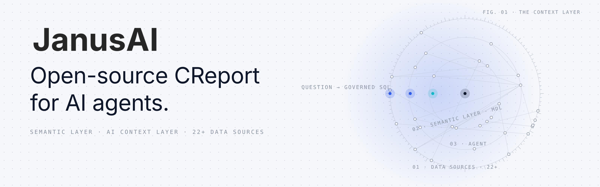
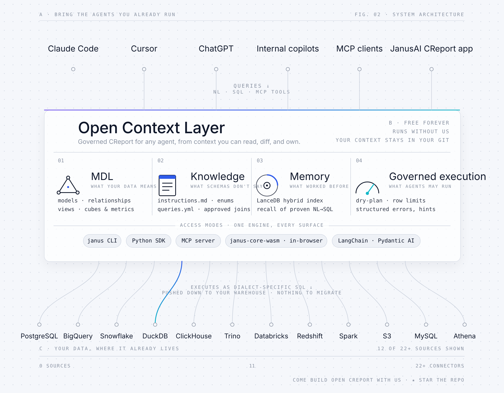

<div align="center" id="top">
<a href="https://crossnow.cn">
  <picture>
    <source media="(prefers-color-scheme: dark)" srcset="./assets/janus-ai-banner-dark.png">
    
  </picture>
</a>

### Open-source CReport for AI agents

**Your agents generate governed SQL, deploy dashboards, and keep business definitions in Git, across 22+ data sources.**

<br/>

🌐 **English** · [简体中文](./README.zh-CN.md)

<br/>

</div>

---

## What JanusAI is

JanusAI is the open-source **generative BI (CReport) engine**. It gives the AI agents you already use (Claude Code, Cursor, MCP clients, LangChain) a **governed semantic layer** and an **AI context layer**, so they turn business questions into correct SQL, ship the answer as a shareable dashboard, and stay inside your guardrails.

Schemas tell an agent where data lives. Janus tells it what the data *means*: approved metric definitions, enums, units, joins, worked examples, and the tribal knowledge buried in docs and chat threads. All of it lives as reviewable YAML and Markdown in a repo you own.

<picture>
  <source media="(prefers-color-scheme: dark)" srcset="./assets/janus-ai-architecture-dark.png">
  
</picture>

## Quickstart

Three commands, then your agent does the rest. Works with Claude Code, Cursor, Cline, Codex, and [50+ other agents](https://docs.crossnow.cn/oss/get_started/quickstart).

**1. Install the CLI**

```bash
pip install janusai
```

Add connector extras as you need them, for example `pip install "janusai[postgres,memory]"`.

**2. Teach your agent about Janus**

```bash
npx skills add CrossNow/JanusAI
```

This installs a ~50-line discovery stub. Your agent fetches full workflow guides from the CLI on demand, so instructions always match the installed version.

**3. Open your agent in a project folder and ask**

> "Use Janus to set up my Postgres database."

The agent checks your environment, creates a connection profile, scaffolds the project, and runs a first query.

**No database handy?** Say "Use Janus with the bundled `jaffle_shop` sample" and run the same flow against a real sample warehouse.

## Feature guide

Each section below is a self-contained workflow. Run the commands from your project folder.

### Define a model in YAML

Models live in `models/<name>/metadata.yml`. Each column maps to a column in your database table:

```yaml
name: orders
table_reference:
  schema: main
  table: orders
columns:
  - name: id
    type: INTEGER
    is_primary_key: true
  - name: amount
    type: DOUBLE
  - name: order_date
    type: DATE
primary_key: id
```

Then check and compile the project:

```bash
janus context validate   # structure, view SQL and description checks
janus context build      # writes target/mdl.json for the engine
janus context show       # models, views and relationships in one view
```

### Translate SQL through the semantic layer without a database

`dry-plan` expands your SQL through the MDL and prints the SQL that would run. It needs no connection:

```bash
janus dry-plan --sql "SELECT id, amount FROM orders" --datasource duckdb
```

### Query your data

Once a [connection profile](https://docs.crossnow.cn/oss/guides/connect) is bound to the project, run queries through the same layer:

```bash
janus --sql "SELECT id, amount FROM orders" --limit 10
janus query --sql "SELECT id, amount FROM orders" --output json   # json, csv or table
```

Add `--quiet` to suppress the hints printed after a query.

### Define a cube for governed aggregates

A cube declares measures and time dimensions on top of a model, so agents ask for `total` by `month` instead of writing `GROUP BY` themselves:

```yaml
# cubes/revenue/metadata.yml
name: revenue
base_object: orders
measures:
  - name: total
    expression: SUM(amount)
    type: DOUBLE
time_dimensions:
  - name: order_date
    expression: order_date
    type: DATE
```

```bash
janus cube list
janus cube query --cube revenue --measures total --time-dimension "order_date:month" --sql-only
```

The `--sql-only` run prints the generated SQL without executing it:

```sql
SELECT DATE_TRUNC('month', order_date) AS order_date__month, SUM(amount) AS total
FROM orders GROUP BY 1 ORDER BY 1
```

Drop `--sql-only` to execute the query. Add `--filter`, `--order-by`, `--limit` or `--from query.json` to refine it.

### Remember NL→SQL pairs and recall them later

Store a question you have confirmed, then search for similar ones:

```bash
janus memory store --nl "total revenue" --sql "SELECT SUM(amount) FROM orders"
janus memory recall --query "revenue"
```

`store` writes the pair to `knowledge/sql/<slug>.md`, which is the source of truth. The grep backend works with no extra install. Install `janusai[memory]` for semantic search with a derived index, and use `janus memory watch` to keep that index fresh.

### Serve Janus tools over MCP

```bash
janus serve mcp                                   # stdio, for local MCP clients
janus serve mcp --transport http --port 8080      # HTTP on 127.0.0.1
```

By default the server exposes read-only tools. Pass `--allow-write` to enable the `store_query` tool, or `--no-connect` to transpile SQL without running it against a database.

### Build and deploy a CReport app

A CReport app is a dashboard built from your project's context layer. The lifecycle is:

```bash
janus creport build     # build instruction for an agent, hydrated from this project
janus creport verify    # required files, parseable MDL, bundled data
janus creport open      # preview the app locally
janus creport deploy    # verify, then ship to your provider account
janus creport list      # registered apps and their deploy state
```

Use `janus creport register` to record an app your agent built in `.janus/apps.yml`.
