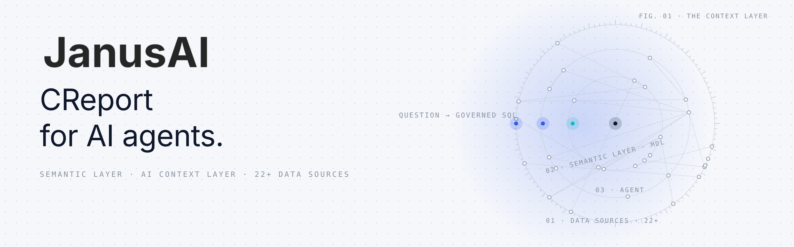
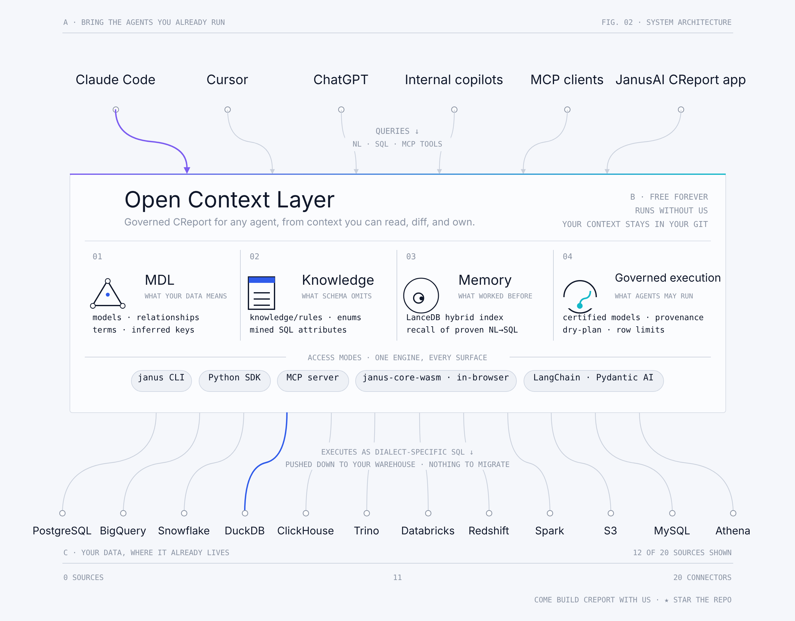

<div align="center" id="top">
<a href="https://crossnow.cn">
  <picture>
    <source media="(prefers-color-scheme: dark)" srcset="./assets/janus-ai-banner-dark.png">
    
  </picture>
</a>

### CReport for AI agents

**Your agents generate governed SQL, deploy dashboards, and keep business definitions in Git, across 20 data sources.**

<br/>

🌐 **English** · [简体中文](./README.zh-CN.md)

<br/>

</div>

---

## What JanusAI is

JanusAI is the **generative BI (CReport) engine**. It gives the AI agents you already use (Claude Code, Cursor, MCP clients, LangChain) a **governed semantic layer** and an **AI context layer**, so they turn business questions into correct SQL, ship the answer as a shareable dashboard, and stay inside your guardrails.

Schemas tell an agent where data lives. Janus tells it what the data *means*: approved metric definitions, enums, units, joins, worked examples, and the tribal knowledge buried in docs and chat threads. All of it lives as reviewable YAML and Markdown in a repo you own.

<picture>
  <source media="(prefers-color-scheme: dark)" srcset="./assets/janus-ai-architecture-dark.png">
  
</picture>

## Quickstart

Three commands, then your agent does the rest. Works with Claude Code, Cursor, Cline, Codex, and [50+ other agents](https://docs.crossnow.cn/oss/get_started/quickstart).

**1. Install the CLI**

```bash
pip install janusai
```

Add connector extras as you need them, for example `pip install "janusai[postgres,memory]"`.

**2. Teach your agent about Janus**

```bash
npx skills add CrossNow/JanusAI
```

This installs a ~50-line discovery stub. Your agent fetches full workflow guides from the CLI on demand, so instructions always match the installed version.

**3. Open your agent in a project folder and ask**

> "Use Janus to set up my Postgres database."

The agent checks your environment, creates a connection profile, scaffolds the project, and runs a first query.

**No database handy?** Say "Use Janus with the bundled `jaffle_shop` sample" and run the same flow against a real sample warehouse.

## Feature guide

Each section below is a self-contained workflow. Run the commands from your project folder.

### Define a model in YAML

Models live in `models/<name>/metadata.yml`. Each column maps to a column in your database table:

```yaml
name: orders
table_reference:
  schema: main
  table: orders
columns:
  - name: id
    type: INTEGER
    is_primary_key: true
  - name: amount
    type: DOUBLE
  - name: order_date
    type: DATE
primary_key: id
```

Then check and compile the project:

```bash
janus context validate   # structure, view SQL and description checks
janus context build      # writes target/mdl.json for the engine
janus context show       # models, views and relationships in one view
```

### Translate SQL through the semantic layer without a database

`dry-plan` expands your SQL through the MDL and prints the SQL that would run. It needs no connection:

```bash
janus dry-plan --sql "SELECT id, amount FROM orders" --datasource duckdb
```

### Connect a database

Create a named connection profile, then bind it to the project. Credentials are stored in `~/.janus/profiles.yml`, not in the project.

```bash
janus profile add mydb --interactive            # prompts for the data source and fields
janus profile add mydb --ui                     # browser form, then saves the profile
janus profile add mydb -f connection.yml        # import from a JSON or YAML file
janus profile add mydb -d postgres --activate   # set the data source, make it active
janus profile list                              # show profiles, highlight the active one
janus profile debug mydb                        # show the resolved config (secrets masked)
janus context set-profile mydb                  # bind the profile to this project
```

**Example configurations.** Put the settings in a YAML file and import it with `janus profile add <name> -f <file>`. Secrets can reference environment variables as `${VAR}`; they are expanded when Janus connects, so the file itself holds no password.

PostgreSQL (`connection.yml`):

```yaml
datasource: postgres
host: localhost
port: "5432"
database: postgres
user: postgres
password: ${POSTGRES_PASSWORD}
```

DuckDB reads CSV, Parquet or JSON files from a directory:

```yaml
datasource: duckdb
url: /data
format: csv          # csv, parquet, json or duckdb
```

Snowflake:

```yaml
datasource: snowflake
account: myaccount
user: admin
password: ${SNOWFLAKE_PASSWORD}
database: mydb
sf_schema: myschema
warehouse: COMPUTE_WH
```

BigQuery takes a base64-encoded service account key in `credentials`:

```yaml
datasource: bigquery
bigquery_type: dataset
project_id: my-project
dataset_id: my_dataset
credentials: ${BIGQUERY_CREDENTIALS}
```

For any other data source, run `janus docs connection-info <datasource>` to see the required fields. Its output is generated from the installed version, so it is the authoritative list.

`--no-validate` skips the connection test after saving. Use `janus profile switch` to change the active profile and `janus profile rm` to remove one.

### Query your data

Once a [connection profile](https://docs.crossnow.cn/oss/guides/connect) is bound to the project, run queries through the same layer:

```bash
janus --sql "SELECT id, amount FROM orders" --limit 10
janus query --sql "SELECT id, amount FROM orders" --output json   # json, csv or table
```

Add `--quiet` to suppress the hints printed after a query.

### Define a cube for governed aggregates

A cube declares measures and time dimensions on top of a model, so agents ask for `total` by `month` instead of writing `GROUP BY` themselves:

```yaml
# cubes/revenue/metadata.yml
name: revenue
base_object: orders
measures:
  - name: total
    expression: SUM(amount)
    type: DOUBLE
time_dimensions:
  - name: order_date
    expression: order_date
    type: DATE
```

```bash
janus cube list
janus cube query --cube revenue --measures total --time-dimension "order_date:month" --sql-only
```

The `--sql-only` run prints the generated SQL without executing it:

```sql
SELECT DATE_TRUNC('month', order_date) AS order_date__month, SUM(amount) AS total
FROM orders GROUP BY 1 ORDER BY 1
```

Drop `--sql-only` to execute the query. Add `--filter`, `--order-by`, `--limit` or `--from query.json` to refine it.

### Remember NL→SQL pairs and recall them later

Store a question you have confirmed, then search for similar ones:

```bash
janus memory store --nl "total revenue" --sql "SELECT SUM(amount) FROM orders"
janus memory recall --query "revenue"
```

`store` writes the pair to `knowledge/sql/<slug>.md`, which is the source of truth. The grep backend works with no extra install. Install `janusai[memory]` for semantic search with a derived index, and use `janus memory watch` to keep that index fresh.

### Check the context against your database

`janus context diff` compares every model with the live schema and reports what has drifted: missing or extra columns, type changes, primary-key differences, and tables no model covers.

```bash
janus context diff                 # all models against the bound database
janus context diff --schema public # one schema or BigQuery dataset
janus context diff --json          # machine-readable report
```

It exits `0` when nothing differs, `1` on drift, and `2` when the database cannot be read, so CI can run it. A composite primary key in the database is noted, not compared, because MDL keys are single columns.

### Draft models and fill in what is not declared

Generate candidate models for tables that have no model yet. Drafts go under `draft/`, and nothing in `models/` changes until you apply one.

```bash
janus context draft --from-db          # drafts for unmodeled tables
janus context infer-fks                # suggest undeclared foreign keys
janus context terms                    # business terms and column display names
janus context attributes               # recurring SQL aggregates and filters
janus context draft apply orders       # promote a draft into models/
```

- **Foreign keys** come from column names (`cust_id` → `customers`), types, and primary keys. Ties go to the embedding API when one is configured, and otherwise stay ambiguous. Tables whose columns are all keys get a join in `draft/bridges.yml`.
- **Terms** drop warehouse prefixes (`dim_order_items` → Order Item) and expand common abbreviations (`qty` → Quantity).
- **Attributes** are mined from the confirmed queries in `knowledge/sql/`. An expression counts once per query, and rare ones are dropped (`--min-occurrences`).
- **Apply** carries the relationships, terms, and display names into the model's `properties`, never overwriting a value you have set, and writes the attributes to `knowledge/attributes/<model>.yml`. If validation fails, the draft is restored.

### Certify definitions, and review agent corrections

Mark a model as certified in its `metadata.yml`:

```yaml
properties:
  certified: "true"
  owner: finance-team
```

Set `require_certified` to `true` in `~/.janus/config.json` to refuse queries that read an uncertified model. Every `run_sql` and `query_cube` result carries `provenance`: the models it used, their certification, and the knowledge files you passed in. An uncertified model also adds a warning.

Agents do not edit models. They queue a correction, and you review it:

```bash
janus serve mcp --allow-write          # enables the propose_correction tool
janus context review                   # list pending corrections
janus context review approve <id>      # merge it into the model, after validation
janus context review reject <id> --reason "not a real problem"
```

### Optional models: embeddings and an LLM

Nothing above needs a model. Two features can use one, and each falls back to a deterministic result when it is missing or fails.

| Used by | Variables |
|---|---|
| Embeddings: semantic recall, foreign-key tie-breaks | `JANUS_EMBEDDING_BACKEND=api`, `JANUS_EMBEDDING_API_BASE_URL`, `JANUS_EMBEDDING_API_MODEL`, optional `JANUS_EMBEDDING_API_KEY`, `JANUS_EMBEDDING_API_ASYMMETRIC=1` for endpoints that need passage and query types |
| LLM: `--suggest-terms`, `--refine-with-model`, `--confirm-with-model` | `JANUS_LLM_BASE_URL`, `JANUS_LLM_MODEL`, optional `JANUS_LLM_API_KEY` |

Without `JANUS_EMBEDDING_BACKEND`, janus uses a local embedding model when one is installed (`pip install "janusai[memory-onnx]"`). Only column names and types are sent to the model, never row values. `examples/model-endpoints/check_endpoints.py` checks both endpoints.

### Serve Janus tools over MCP

```bash
janus serve mcp                                   # stdio, for local MCP clients
janus serve mcp --transport http --port 8080      # HTTP on 127.0.0.1
```

Flags:

| Flag | Effect |
|---|---|
| `--transport stdio\|http` | Transport (default `stdio`). |
| `--host`, `--port` | Bind address for `http` (default `127.0.0.1:8080`). |
| `--project PATH` | Project root, if not the current directory. |
| `--profile NAME` | Connection profile to use. |
| `--allow-write` | Enable the `store_query` write tool. Off by default. |
| `--no-connect` | Transpile only: disables `run_sql`, `dry_run` and `query_cube`. |

**Tools**

| Group | Tool | What it does |
|---|---|---|
| Query | `run_sql` | Run SQL against MDL model names and return rows (default 1000 rows, max 10000). |
| Query | `dry_run` | Check SQL against the data source without returning rows. |
| Query | `dry_plan` | Expand SQL through the MDL without connecting to a database. |
| Query | `query_cube` | Run a structured cube query, or return its SQL with `sql_only`. |
| Models | `get_mdl`, `list_models`, `describe_model` | Read the compiled MDL, or list and describe models. `describe_model` also returns the term, aliases, and column display names. |
| Models | `get_data_source`, `describe_schema`, `list_functions` | Data source details, the full schema, and supported functions. |
| Cubes | `list_cubes`, `describe_cube` | List cubes and their measures and dimensions. |
| Knowledge | `get_instructions`, `get_context` | Business rules and project context for the agent. |
| Knowledge | `list_knowledge`, `list_stored_queries` | Browse knowledge files and stored NL→SQL pairs. |
| Knowledge | `list_attributes` | Mined SQL attributes for a model, from `knowledge/attributes/`. |
| Recall | `recall_queries` | Search past NL→SQL pairs by natural language. |
| Write | `store_query` | Save a confirmed NL→SQL pair to `knowledge/sql/`. Requires `--allow-write`. |
| Write | `propose_correction` | Queue a proposed change to a model for review in `knowledge/corrections/`. Requires `--allow-write`. |

**Resources**

- `janus://mdl`: the compiled MDL.
- `janus://instructions`: business rules.
- `janus://project`: name, catalog, schema and data source from `janus_project.yml`.
- `janus://agents`: the project's `AGENTS.md`, if present.
- `janus://knowledge/{name}` and `janus://knowledge/{subdir}/{name}`: knowledge files.

**Prompt**

- `janus_workflow`: a guided workflow for answering a data question with Janus.

### Serve Janus over HTTP

`janus serve api` exposes the same query and context endpoints as MCP, as JSON:

```bash
janus serve api                             # 127.0.0.1:8090
janus serve api --port 9000 --token "$TOKEN"
```

| Method | Path | Returns |
|---|---|---|
| GET | `/health` | liveness |
| GET | `/models`, `/models/{name}` | models, with certification |
| POST | `/query` | rows and `provenance`; body `{"sql", "limit"?, "knowledge"?, "include_sql"?}` |
| POST | `/dry-plan` | expanded SQL, without touching the database |

Binding a non-loopback address requires `--token` (or `JANUS_API_TOKEN`). Requests without `Authorization: Bearer <token>` get `401`.

### Build and deploy a CReport app

A CReport app is a dashboard built from your project's context layer. The lifecycle is:

```bash
janus creport build     # build instruction for an agent, hydrated from this project
janus creport verify    # required files, parseable MDL, bundled data
janus creport open      # preview the app locally
janus creport deploy    # verify, then ship to your provider account
janus creport list      # registered apps and their deploy state
```

Use `janus creport register` to record an app your agent built in `.janus/apps.yml`.
