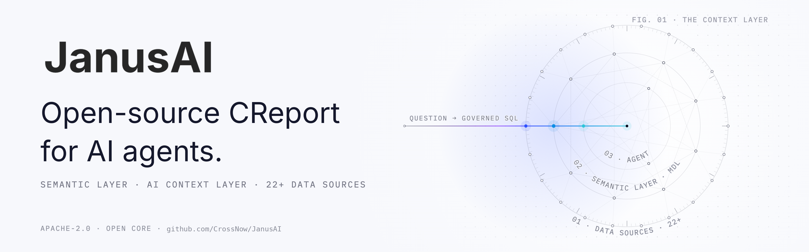
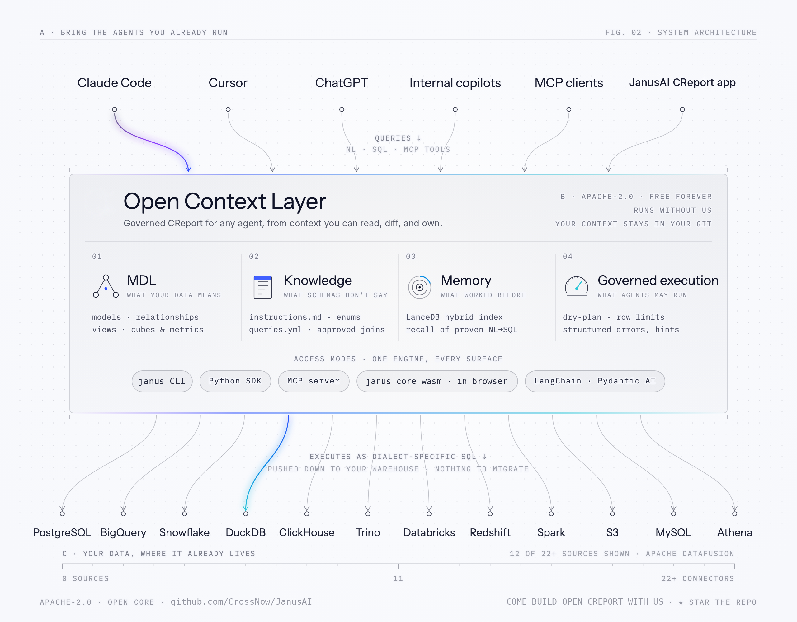

<div align="center" id="top">
<a href="https://crossnow.cn">
  <picture>
    <source media="(prefers-color-scheme: dark)" srcset="./misc/janus-ai-banner-dark.png">
    
  </picture>
</a>

### 面向 AI 智能体的开源 GenBI

**让你的智能体生成受治理的 SQL、部署仪表盘，并把业务定义保存在 Git 中，覆盖 22+ 种数据源。**

<br/>

**[三条命令快速开始 ↓](#快速开始)** &nbsp;·&nbsp; **[阅读文档 →](https://docs.crossnow.cn)** &nbsp;·&nbsp; **[加入 Discord →](https://discord.gg/5DvshJqG8Z)**

<br/>

🌐 [English](./README.md) · **简体中文**

<br/>

[](https://github.com/CrossNow/JanusAI/blob/main/LICENSE)
[](https://pypi.org/project/janusai/)
[](https://github.com/CrossNow/JanusAI/releases)
[](https://discord.gg/5DvshJqG8Z)
[](https://x.com/getwrenai)


<a href="https://trendshift.io/repositories/9263" target="_blank"></a>

</div>

---

## JanusAI 是什么

JanusAI 是开源的**生成式 BI（GenBI）引擎**。它为你已经在用的 AI 智能体（Claude Code、Cursor、MCP 客户端、LangChain）提供一个**受治理的语义层**和一个 **AI 上下文层**，让它们把业务问题转换为正确的 SQL、把结果发布为可分享的仪表盘，并始终处在你设定的护栏之内。

Schema 只能告诉智能体数据存放在哪里。Janus 则告诉它数据**意味着什么**：经过批准的指标定义、枚举值、单位、关联关系、示例，以及埋在文档和聊天记录里的隐性知识。这些内容都以可审阅的 YAML 和 Markdown 文件保存在你自己的代码仓库中。

<picture>
  <source media="(prefers-color-scheme: dark)" srcset="./misc/janus-ai-architecture-dark.png">
  
</picture>

## 快速开始

三条命令，剩下的交给你的智能体。支持 Claude Code、Cursor、Cline、Codex，以及 [50+ 其他智能体](https://docs.crossnow.cn/oss/get_started/quickstart)。

**1. 安装 CLI**

```bash
pip install janusai
```

按需添加连接器依赖，例如 `pip install "janusai[postgres,memory]"`。

**2. 让你的智能体了解 Janus**

```bash
npx skills add CrossNow/JanusAI
```

这会安装一个约 50 行的发现存根。智能体会按需从 CLI 获取完整的工作流指南，因此说明始终与已安装的版本一致。

**3. 在项目目录中打开你的智能体并提问**

> "用 Janus 帮我设置 Postgres 数据库。"

智能体会检查环境、创建连接配置文件、搭建项目结构，并运行第一条查询。

**手边没有数据库？** 直接说"用 Janus 配合内置的 `jaffle_shop` 示例数据"，同样的流程就会在一个真实的示例数据仓库上运行。

<details>
<summary>中国大陆用 <code>pip install</code> 很慢？</summary>

```bash
pip install janusai -i https://pypi.tuna.tsinghua.edu.cn/simple
```

如果 HuggingFace 模型下载超时，在使用 CLI 之前执行 `export HF_ENDPOINT=https://hf-mirror.com`。

</details>

### 接下来

连接成功后，下面三类提问覆盖了整个 GenBI 流程：

| 阶段 | 向智能体提问 | 发生的事情 |
|---|---|---|
| **理解** | "用 `raw/` 里的业务背景补充我的 Janus 项目。" | 运行 `janus skills get enrich-context`，把定义、示例和记忆写成可审阅的文件。 |
| **生成** | "本季度销售额前 10 的客户是谁？" | 检索 MDL 上下文和历史查询，编写受治理的 SQL，并通过 `janus query` 执行。 |
| **部署** | "把结果做成可筛选、可分享的仪表盘，部署到 Vercel。" | 运行 `janus skills get genbi`，构建一个浏览器端应用，并在你的 Vercel 或 Cloudflare Pages 账号上返回可访问的链接。 |

<div align="center">

**[查看完整快速开始 →](https://docs.crossnow.cn/oss/get_started/quickstart)** &nbsp;·&nbsp; [构建并部署 GenBI 应用 →](https://docs.crossnow.cn/oss/guides/genbi)

</div>

## 为什么智能体开发者选择 JanusAI

- **既出答案，也出仪表盘。** 生成一个受治理的答案，把它部署为仪表盘，然后分享链接。整个流程由智能体端到端驱动。
- **正确，而不是自信地出错。** Schema 感知的检索、MDL 规划、dry-plan 校验、行数限制、取值画像，以及带提示的结构化错误，让智能体生成的 SQL 保持在护栏之内。
- **业务含义保存在 Git 中。** 指标定义、枚举、经批准的关联关系和经过验证的示例都是有版本的文件。可以在 Pull Request 中审阅、对比，也可以随时带走。
- **通过你已经在用的智能体工作。** Claude Code、Cursor、Cline、Codex、MCP 客户端、LangChain。Janus 是一个层，而不是需要你额外采用的另一套聊天界面。
- **运行在你现有的技术栈之上。** 数据仓库、转换流水线、已有的语义模型。22+ 种数据源共用一个基于 Apache DataFusion 的引擎。
- **默认开放。** 核心引擎、SDK 和 Skills 均采用 Apache-2.0 许可。它不依赖我们也能运行。

### Janus 与其他方案的对比

|  | 原始 LLM 智能体 | 传统 BI 工具 | 单纯的语义层 | **JanusAI** |
|---|:---:|:---:|:---:|:---:|
| 为你编写 SQL | ✅（常常出错） | ❌ | ❌ | ✅ 受治理 |
| 理解你的业务定义 | ❌ | 部分，仅限工具内 | ✅（仅 Schema） | ✅ + 非 Schema 知识 |
| 生成并部署仪表盘 | ❌ | ✅（手动，工具内） | ❌ | ✅ 由智能体驱动 |
| 通过*你的*智能体工作（Claude Code、Cursor、MCP……） | ✅ | ❌ | ❌ | ✅ |
| 开放、可审阅、适合 Git 的上下文 | ❌ | ❌ | 部分 | ✅ |
| 跨 22+ 数据源的受治理执行 | ❌ | 每个连接器单独实现 | ✅（仅定义） | ✅ |

### 以下情况适合使用 Janus……

- 你希望 **AI 智能体产出可信的 BI**，既有答案也有仪表盘，而不只是看似合理的 SQL。
- 你的业务逻辑（定义、枚举、单位、经批准的关联）存在于**数据库之外**，而你的智能体一直在出错。
- 你希望拥有一个**开放、可审阅、有版本控制**的上下文层，供每个智能体和每个人使用，而不是被某个厂商的界面锁定。

**如果你只需要从单个 CSV 生成一张图表，或者你乐于让智能体在没有任何治理的情况下猜测 SQL，那就不需要 Janus。**

## 用 `git push` 把它带给你的团队

Janus 在你笔记本上写入的一切，都是保存在你自己代码仓库中的普通 YAML 和 Markdown。**Git Sync** 可以把同一个仓库变成 Janus Cloud 或自托管部署（包括离线环境）中、面向整个团队的受治理 GenBI 部署。无需导出，也无需重新建模。

- **无需学习新的 CLI。** 用 `janus cloud create` 或 `janus cloud link` 绑定一次目录。之后，`git push` 和 `git pull` 就是全部的操作接口。
- **指标像代码一样评审。** 对 `net_revenue` 的修改会在 GitHub、GitLab、Bitbucket 或你自己的远程仓库中以可读的 diff 形式出现在 Pull Request 里。可以对它运行 CI，并像发布应用代码一样把 staging 推进到 production。
- **仓库始终归你所有。** 随时克隆、备份、交给其他工具使用，或带着它离开。
- **磁盘上没有可复用的凭据。** 每次推送都使用一个 600 秒后过期的新令牌。长期密钥保存在 `~/.janus/cloud.yml`（权限 `0600`）中，从不交给 git。

```bash
$ git push
To cloud.crossnow.cn/acme/janus-analytics.git
   9f2c1a4..b71e0d3  main -> main
✔ deploy queued · model queryable in Janus Cloud
```

<div align="center">

**[了解 Git Sync 如何工作 →](https://www.crossnow.cn/git-sync)** &nbsp;·&nbsp; [CLI 参考：`janus cloud`](./docs/core/reference/cli.md#janus-cloud--connect-a-project-to-janus-cloud)

</div>

### 开源核心：哪些开源，哪些是商业的

本仓库中的引擎（MDL 语义层、受治理的 text-to-SQL、MCP 服务器、CLI、22+ 连接器）采用 Apache-2.0 许可，永久免费，并可自托管。以下功能属于商业版本，以 **Janus AI Cloud** 或自托管的 **Enterprise Plus** 形式提供：

- **行级和列级安全**，以及用户和用户组的访问控制
- **GenBI 界面、仪表盘、嵌入式能力和 API**
- **场景化 AI 工具链**：GenBI 应用、Agentic 模式、AI 辅助的上下文准备
- **高级安全与审计、支持服务和 SLA**，以及云端、VPC 和离线部署

底层是同一个引擎。无论哪种方式，你的 MDL 都保存在你自己的 Git 中。**[阅读已公布的开源边界 →](https://www.crossnow.cn/en/open-core)**

## 技术细节

### 语义层（MDL）

Janus **就是**一个受治理的语义层，使用 **建模定义语言（MDL）** 表达：它以 Git 友好的方式定义你的数据*意味着什么*，而不仅仅是数据存放在哪里。每个答案和仪表盘都基于它进行规划。

- **模型、列、关联关系、视图**：数据的结构，与具体某个数据仓库解耦。
- **Cube 与指标**：经过批准、可复用的定义，让"收入"在任何地方含义一致。
- **Schema 之外的上下文**：枚举、单位、经批准的关联，以及 `instructions.md` 和 `queries.yml` 中的定义。

### 包含的内容

- **引擎**：基于 Apache DataFusion。支持 BigQuery、Snowflake、PostgreSQL、ClickHouse、Amazon Redshift、Databricks、DuckDB 等。[连接数据库 →](https://docs.crossnow.cn/oss/guides/connect)
- **GenBI 仪表盘**：由智能体构建的浏览器端应用，由 [`janus-core-wasm`](https://docs.crossnow.cn/oss/sdk/wasm) 驱动，可部署到 Vercel 或 Cloudflare Pages
- **知识与记忆**：版本化的 `instructions.md` 和 `queries.yml`，以及本地 LanceDB 记忆索引，支持混合检索
- **智能体 SDK**：`janus-langchain`（LangChain / LangGraph）、`janus-pydantic`，以及用于其他技术栈的参考 Python 集成。[SDK 概览 →](https://docs.crossnow.cn/oss/sdk/overview)
- **受治理的执行原语**：函数、dry-plan 校验、行数限制、结构化错误

### 日常命令

```bash
janus skills get onboarding         # 工作流指南：设置项目并完成第一条查询
janus skills get enrich-context     # 工作流指南：补充业务上下文
janus skills get genbi              # 工作流指南：构建并部署仪表盘

janus query --sql '...'             # 通过 MDL 语义层执行查询
janus ask "<question>" --guided     # 为能力较弱的智能体包装问题
janus ask "<question>" --direct     # 为能力较强的智能体包装问题
```

完整参考：[CLI](./docs/core/reference/cli.md) · [MDL](./docs/core/reference/mdl.md) · [架构](./docs/core/reference/architecture.md)

### 下一步计划

- **端到端的正确性原语**：取值画像、丰富的检索、结构化错误、黄金评测运行器
- **原生智能体分发**：覆盖主流智能体框架的一流 SDK

请在 [GitHub Discussions →](https://github.com/CrossNow/JanusAI/discussions) 中投票决定下一步交付的内容。

## 常见问题

<details>
<summary><b>什么是生成式 BI（GenBI）？</b></summary>

由 AI 智能体生成的商业智能。不再由人手工制作图表，而是由智能体生成受治理的 SQL、部署仪表盘并分享出去，其结果基于 AI 上下文层，因此是可信的，而不只是看似合理。Janus AI 是开源的 GenBI 引擎。

</details>

<details>
<summary><b>Janus AI 支持 text-to-SQL 吗？</b></summary>

支持，而且是受治理的：问题会被转换为基于语义层（MDL）规划的 SQL，并在执行前经过 dry-plan 校验。Janus 还会进一步部署仪表盘，并管理使答案保持正确的上下文。

</details>

<details>
<summary><b>Janus AI 是语义层吗？</b></summary>

是的。Janus 是用 MDL（模型、指标、关联关系）表达的受治理语义层，并配有 AI 上下文层（记忆、示例、非结构化知识）和一个受治理的执行引擎，后者可以跨 22+ 种数据源运行这些定义。

</details>

<details>
<summary><b>什么是 AI 上下文层？</b></summary>

智能体需要、但 Schema 无法提供的可审阅、有版本控制的知识：业务语义、经批准的定义、示例、记忆和治理规则。可以阅读这篇文章了解其设计理念：[The missing context layer for AI agents over business data](https://www.crossnow.cn/post/the-missing-context-layer-for-ai-agents-over-business-data)。

</details>

<details>
<summary><b>基于 Docker 的 Janus AI GenBI 应用怎么样了？</b></summary>

2026-05-07，Janus Engine 合并进本仓库的 [`core/`](./core) 目录，之前的 wren-engine 仓库已归档。原先的聊天式 BI 产品现在称为 **Janus GenBI Classic**，保留在 [`legacy/v1`](https://github.com/CrossNow/JanusAI/tree/legacy/v1) 分支（标签 `v1-final`）上，不再添加新功能或安全修复。如需使用受维护的托管版本，请访问 [Janus AI Commercial](https://crossnow.cn)。[阅读公告 →](https://github.com/CrossNow/JanusAI/discussions/2205)

</details>

## 文档

- [快速开始](https://docs.crossnow.cn/oss/get_started/quickstart)：从安装 Skill 到得到第一个答案
- [构建并部署 GenBI 应用](https://docs.crossnow.cn/oss/guides/genbi)：生成仪表盘并上线
- [核心概念](https://docs.crossnow.cn/oss/concepts/what_is_context)：什么是上下文、什么是 MDL、记忆如何工作
- [连接数据库](https://docs.crossnow.cn/oss/guides/connect)：Postgres、BigQuery、Snowflake、DuckDB 等
- [智能体 SDK](https://docs.crossnow.cn/oss/sdk/overview)：当前已发布的内容和下一步计划
- [Git Sync](https://www.crossnow.cn/git-sync)：用 `git push` 把你的开源项目推送到受治理的、面向团队的 GenBI

中文文档：[`docs/core/zh-CN/`](./docs/core/zh-CN/README.md)

## 社区

- 💬 [Discord](https://discord.gg/5DvshJqG8Z)：快速解决问题，与团队和其他开发者交流
- 🐙 [GitHub Discussions](https://github.com/CrossNow/JanusAI/discussions)：设计讨论、RFC、路线图投票
- 🐦 [Twitter / X](https://x.com/getwrenai)：发布说明和简讯
- 🗞 [博客](https://www.crossnow.cn/blog)：愿景、复盘和深度文章

## 参与贡献

我们公开开发。欢迎提交 Issue、PR、连接器、SDK 集成和文档修正。

- **刚接触本项目？** 可以从 [`good first issue`](https://github.com/CrossNow/JanusAI/labels/good%20first%20issue) 开始。
- [贡献者指南](./CONTRIBUTING.md)：环境搭建、约定和贡献标准
- [架构图](./docs/core/reference/architecture.md)：找到适合你修改的位置

<details>
<summary><b>项目结构（点击展开）</b></summary>

```
core/
  janus-core/         Rust 语义引擎（Apache DataFusion）
  janus-core-base/    共享的 manifest 类型 + MDL 构建器
  janus-core-py/      Python 绑定（PyPI: janus-core）
  janus-core-wasm/    WebAssembly 构建（npm: janus-core-wasm）
  janus/              Python SDK 和 CLI（PyPI: janusai）
  janus-mdl/          MDL JSON Schema
sdk/
  janus-langchain/    LangChain / LangGraph 集成
  janus-pydantic/     Pydantic AI 集成
skills/              用于编写上下文的智能体 Skills
docs/                模块文档
examples/            示例项目
```

</details>

## 贡献者

<a href="https://github.com/CrossNow/JanusAI/graphs/contributors">
  
</a>

## 许可证

Apache 2.0。详见 [LICENSE](./LICENSE)。

---

<div align="center">

**如果 JanusAI 帮你节省了时间，欢迎[给仓库点个 Star](https://github.com/CrossNow/JanusAI) ⭐。这是帮助更多智能体开发者发现它的最快方式。**

**[回到快速开始 ↑](#快速开始)** &nbsp;·&nbsp; **[加入 Discord →](https://discord.gg/5DvshJqG8Z)** &nbsp;·&nbsp; **[查看 Git Sync →](https://www.crossnow.cn/git-sync)**

<p><a href="#top">⬆️ 返回顶部</a></p>

</div>
