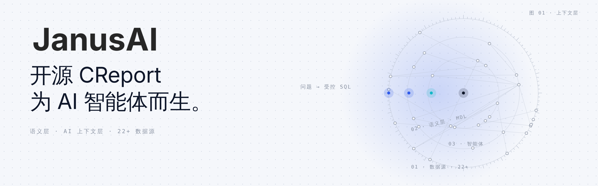
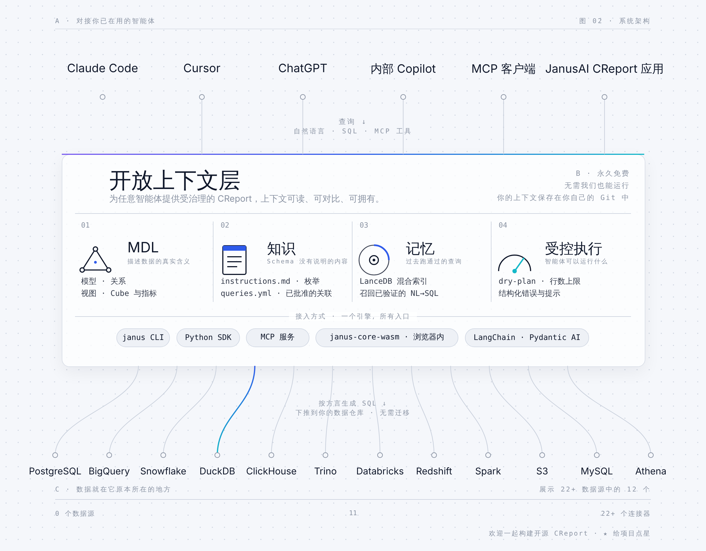

<div align="center" id="top">
<a href="https://crossnow.cn">
  <picture>
    <source media="(prefers-color-scheme: dark)" srcset="./assets/janus-ai-banner-dark.zh-CN.png">
    
  </picture>
</a>

### 面向 AI 智能体的 CReport

**让你的智能体生成受治理的 SQL、部署仪表盘，并把业务定义保存在 Git 中，覆盖 22+ 种数据源。**

<br/>

🌐 [English](./README.md) · **简体中文**

<br/>

</div>

---

## JanusAI 是什么

JanusAI 是**生成式 BI（CReport）引擎**。它为你已经在用的 AI 智能体（Claude Code、Cursor、MCP 客户端、LangChain）提供一个**受治理的语义层**和一个 **AI 上下文层**，让它们把业务问题转换为正确的 SQL、把结果发布为可分享的仪表盘，并始终处在你设定的护栏之内。

Schema 只能告诉智能体数据存放在哪里。Janus 则告诉它数据**意味着什么**：经过批准的指标定义、枚举值、单位、关联关系、示例，以及埋在文档和聊天记录里的隐性知识。这些内容都以可审阅的 YAML 和 Markdown 文件保存在你自己的代码仓库中。

<picture>
  <source media="(prefers-color-scheme: dark)" srcset="./assets/janus-ai-architecture-dark.zh-CN.png">
  
</picture>

## 快速开始

三条命令，剩下的交给你的智能体。支持 Claude Code、Cursor、Cline、Codex，以及 [50+ 其他智能体](https://docs.crossnow.cn/oss/get_started/quickstart)。

**1. 安装 CLI**

```bash
pip install janusai
```

按需添加连接器依赖，例如 `pip install "janusai[postgres,memory]"`。

**2. 让你的智能体了解 Janus**

```bash
npx skills add CrossNow/JanusAI
```

这会安装一个约 50 行的发现存根。智能体会按需从 CLI 获取完整的工作流指南，因此说明始终与已安装的版本一致。

**3. 在项目目录中打开你的智能体并提问**

> "用 Janus 帮我设置 Postgres 数据库。"

智能体会检查环境、创建连接配置文件、搭建项目结构，并运行第一条查询。

**手边没有数据库？** 直接说"用 Janus 配合内置的 `jaffle_shop` 示例数据"，同样的流程就会在一个真实的示例数据仓库上运行。

## 功能使用指南

下面每一节都是独立的工作流程。请在你的项目目录中运行这些命令。

### 用 YAML 定义模型

模型位于 `models/<name>/metadata.yml`，每一列对应数据库表中的一列：

```yaml
name: orders
table_reference:
  schema: main
  table: orders
columns:
  - name: id
    type: INTEGER
    is_primary_key: true
  - name: amount
    type: DOUBLE
  - name: order_date
    type: DATE
primary_key: id
```

然后检查并编译项目：

```bash
janus context validate   # 结构、视图 SQL 与描述检查
janus context build      # 为引擎写入 target/mdl.json
janus context show       # 一览模型、视图和关系
```

### 无需数据库，通过语义层转换 SQL

`dry-plan` 会通过 MDL 展开你的 SQL，并打印实际将要执行的 SQL。它不需要连接数据库：

```bash
janus dry-plan --sql "SELECT id, amount FROM orders" --datasource duckdb
```

### 配置数据库连接

创建一个命名的连接配置文件，再把它绑定到项目。凭据保存在 `~/.janus/profiles.yml` 中，不会写进项目。

```bash
janus profile add mydb --interactive            # 交互式输入数据源和字段
janus profile add mydb --ui                     # 打开浏览器表单，保存后生效
janus profile add mydb -f connection.yml        # 从 JSON 或 YAML 文件导入
janus profile add mydb -d postgres --activate   # 指定数据源，并设为当前配置
janus profile list                              # 列出配置，高亮当前配置
janus profile debug mydb                        # 显示解析后的配置（敏感字段已遮蔽）
janus context set-profile mydb                  # 把配置绑定到当前项目
```

`--no-validate` 会在保存后跳过连接测试。用 `janus profile switch` 切换当前配置，用 `janus profile rm` 删除配置。

### 查询数据

项目绑定 [连接配置](https://docs.crossnow.cn/oss/guides/connect) 之后，就可以通过同一语义层执行查询：

```bash
janus --sql "SELECT id, amount FROM orders" --limit 10
janus query --sql "SELECT id, amount FROM orders" --output json   # 可选 json、csv 或 table
```

加上 `--quiet` 可以隐藏查询后的提示信息。

### 为受治理的聚合定义 Cube

Cube 在模型之上声明度量和时间维度，让智能体直接请求"按月的 `total`"，而不必自己编写 `GROUP BY`：

```yaml
# cubes/revenue/metadata.yml
name: revenue
base_object: orders
measures:
  - name: total
    expression: SUM(amount)
    type: DOUBLE
time_dimensions:
  - name: order_date
    expression: order_date
    type: DATE
```

```bash
janus cube list
janus cube query --cube revenue --measures total --time-dimension "order_date:month" --sql-only
```

`--sql-only` 只打印生成的 SQL，不执行：

```sql
SELECT DATE_TRUNC('month', order_date) AS order_date__month, SUM(amount) AS total
FROM orders GROUP BY 1 ORDER BY 1
```

去掉 `--sql-only` 即可执行查询。还可以使用 `--filter`、`--order-by`、`--limit` 或 `--from query.json` 进一步细化。

### 保存 NL→SQL 对并在之后召回

保存一个已经确认的问题，然后搜索相似的问题：

```bash
janus memory store --nl "total revenue" --sql "SELECT SUM(amount) FROM orders"
janus memory recall --query "revenue"
```

`store` 会把该对写入 `knowledge/sql/<slug>.md`，这是事实来源。grep 后端无需额外安装。安装 `janusai[memory]` 后可以使用语义搜索和派生索引，并用 `janus memory watch` 让索引保持最新。

### 通过 MCP 提供 Janus 工具

```bash
janus serve mcp                                   # stdio，供本地 MCP 客户端使用
janus serve mcp --transport http --port 8080      # HTTP，绑定 127.0.0.1
```

启动参数：

| 参数 | 作用 |
|---|---|
| `--transport stdio\|http` | 传输方式（默认 `stdio`）。 |
| `--host`、`--port` | `http` 模式的绑定地址（默认 `127.0.0.1:8080`）。 |
| `--project PATH` | 项目根目录，不在当前目录时使用。 |
| `--profile NAME` | 使用的连接配置文件。 |
| `--allow-write` | 启用 `store_query` 写入工具，默认关闭。 |
| `--no-connect` | 只做转换：禁用 `run_sql`、`dry_run` 和 `query_cube`。 |

**工具**

| 类别 | 工具 | 作用 |
|---|---|---|
| 查询 | `run_sql` | 用 MDL 模型名执行 SQL 并返回行数据（默认最多 1000 行，上限 10000 行）。 |
| 查询 | `dry_run` | 在数据源上校验 SQL，不返回数据。 |
| 查询 | `dry_plan` | 通过 MDL 展开 SQL，不连接数据库。 |
| 查询 | `query_cube` | 执行结构化 Cube 查询；设置 `sql_only` 时只返回 SQL。 |
| 模型 | `get_mdl`、`list_models`、`describe_model` | 读取编译后的 MDL，列出并描述模型。 |
| 模型 | `get_data_source`、`describe_schema`、`list_functions` | 数据源信息、完整 Schema 和可用函数。 |
| Cube | `list_cubes`、`describe_cube` | 列出 Cube 及其度量和维度。 |
| 知识 | `get_instructions`、`get_context` | 供智能体使用的业务规则和项目上下文。 |
| 知识 | `list_knowledge`、`list_stored_queries` | 浏览知识文件和已保存的 NL→SQL 对。 |
| 召回 | `recall_queries` | 按自然语言搜索历史 NL→SQL 对。 |
| 写入 | `store_query` | 把确认过的 NL→SQL 对保存到 `knowledge/sql/`，需要 `--allow-write`。 |

**资源**

- `janus://mdl`：编译后的 MDL。
- `janus://instructions`：业务规则。
- `janus://project`：`janus_project.yml` 中的名称、catalog、schema 和数据源。
- `janus://agents`：项目的 `AGENTS.md`（如果存在）。
- `janus://knowledge/{name}` 和 `janus://knowledge/{subdir}/{name}`：知识文件。

**提示词**

- `janus_workflow`：引导智能体用 Janus 回答数据问题的工作流程。

### 构建并部署 CReport 应用

CReport 应用是基于项目上下文层构建的仪表盘，生命周期如下：

```bash
janus creport build     # 为智能体生成的构建指令，已结合本项目的上下文
janus creport verify    # 检查必需文件、MDL 可解析性和内置数据
janus creport open      # 在本地预览应用
janus creport deploy    # 先校验，再部署到你的服务商账户
janus creport list      # 已注册的应用及其部署状态
```

如果智能体构建了应用，使用 `janus creport register` 把它记录到 `.janus/apps.yml` 中。
