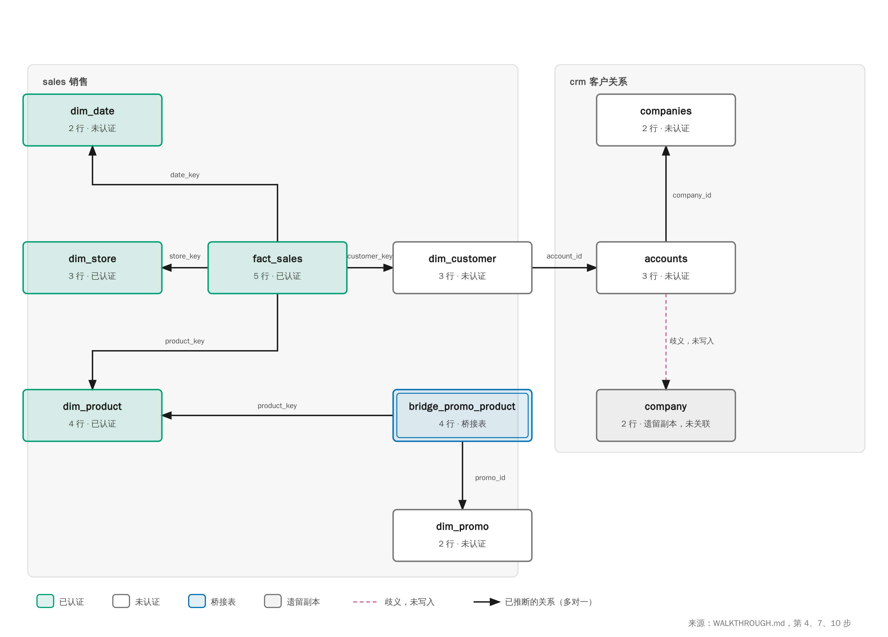

# 复杂本体演示：背景与逐步数据

这份文档讲清楚演示的业务背景，然后逐步给出真实的运行结果。每个数字都来自实际运行
`run_complex_demo.sh` 的输出，或是对仓库数据的直接查询，不是估算。运行方式见
[README](README.md)。

## 背景

一家零售公司有两个数据区域，由不同的团队维护：

- **销售（`sales` schema）**：一张事实表 `fact_sales`，记录每一笔销售，加上日期、门店、
  产品、客户四张维度表，以及一张促销与产品的关联表。这是典型的星型结构，但表之间
  **没有声明任何外键**，因为数据是从业务系统一批批导入的。
- **客户关系（`crm` schema）**：客户账户 `accounts` 归属于公司。公司表有两份：
  `companies` 是现在在用的，`company` 是几年前留下的副本，两者都有 `company_id`。

这带来四个典型问题：

1. 分析师想按类别、门店、客户统计收入，但没有可以依赖的关联关系。
2. `accounts.company_id` 既可以指向 `companies`，也可以指向 `company`，需要人来决定。
3. 同一个指标在不同查询里写法不一样（`SUM(net_amount)` 和 `SUM(f.net_amount)`），
   需要被识别为同一个度量。
4. 财务要求只有经过认证的数字才能用于报表；代理（agent）提出的修正不能直接改模型。

演示要把这些问题依次走完：从原始表开始，建立一个可审核、可对照数据库、可认证的本体。

## 数据规模

仓库中的数据如下（来自 `make_retail_warehouse.py`）：

| 表 | 行数 | 说明 |
|---|---|---|
| `sales.fact_sales` | 5 | 每行一笔销售，含净额 `net_amount` 与数量 `qty` |
| `sales.dim_date` | 2 | 2025 年 1、2 月 |
| `sales.dim_store` | 3 | 柏林、里昂、奥斯汀 |
| `sales.dim_product` | 4 | 台灯、升降桌、办公椅、落地灯 |
| `sales.dim_customer` | 3 | 三位客户，各自关联一个账户 |
| `sales.dim_promo` | 2 | 两次促销 |
| `sales.bridge_promo_product` | 4 | 促销与产品的对应关系，纯关联表 |
| `crm.accounts` | 3 | 三个账户，分别挂在两家公司下 |
| `crm.companies` / `crm.company` | 2 / 2 | 两份公司表，第二份是遗留副本 |

---

## 第 1 步：建立仓库

**做什么**：生成两个 schema 的 DuckDB 仓库。

**真实输出**：

```
wrote .../work/warehouse/retail.duckdb
```

**结论**：仓库里没有任何外键约束，所以后面的关联全部要靠推断。

## 第 2 步：配置连接与空项目

**做什么**：写入 profile，指向仓库目录；创建一个空项目，并把 `data_source` 改为 `duckdb`。

**真实输出**：无输出（命令静默成功）。

**结论**：项目通过 profile 绑定到仓库，之后所有 `diff` 与查询都经过这条连接。

## 第 3 步：按 schema 草拟候选模型

**做什么**：先对 `sales` 再对 `crm` 运行 `context draft --from-db`。

**真实输出**：

```
Drafted 7 model(s) under draft/models/.
  + bridge_promo_product, dim_customer, dim_date, dim_product, dim_promo, dim_store, fact_sales
  note: bridge_promo_product: composite primary key ['promo_id', 'product_key'] left out
Drafted 3 model(s) under draft/models/.
  + accounts, companies, company
```

**数据**：一共 **10 个草稿**。`bridge_promo_product` 的复合主键 `(promo_id, product_key)`
无法用 MDL 表达（MDL 的主键只能是单列），所以它的主键被省略，并记录了一条说明。

**结论**：每张表都有了候选模型，但还没有任何关系。

## 第 4 步：推断未声明的外键

**做什么**：运行 `context infer-fks`，规则是：列名词干与模型名匹配（支持单复数与仓库前缀），
类型一致，目标是单列主键。

**真实输出**（节选）：

```
ambiguous  accounts.company_id -> companies.company_id  (score 0.8, rule)
           candidates: companies, company
suggested  dim_customer.account_id -> accounts.id  (score 0.8, rule)
suggested  fact_sales.date_key -> dim_date.date_key  (score 0.8, rule)
suggested  fact_sales.store_key -> dim_store.store_key  (score 0.8, rule)
suggested  fact_sales.product_key -> dim_product.product_key  (score 0.8, rule)
suggested  fact_sales.customer_key -> dim_customer.customer_key  (score 0.8, rule)
suggested  bridge_promo_product.promo_id -> dim_promo.promo_id  (score 0.8, rule)
suggested  bridge_promo_product.product_key -> dim_product.product_key  (score 0.8, rule)
bridge     bridge_promo_product links dim_product and dim_promo
Wrote 7 relationship(s) and 1 bridge(s) under draft/.
```

**数据**：

- 8 条建议中，7 条被接受为关系（`accounts.company_id` 因歧义未写入）。
- 带前缀的 `dim_store`、`dim_product` 能被匹配到，说明前缀处理是有效的。
- 所有精确匹配的得分都是 0.8；如果名字只是缩写，得分会降为 0.5（本演示中没有这种情况）。
- `bridge_promo_product` 被识别为桥接表：它的两列都是外键，且没有其他列，所以生成了一条
  `dim_product ↔ dim_promo` 的 join。

**结论**：推断出了跨表、带前缀、以及桥接的关系；唯一的歧义被明确标出，而不是猜测。

## 第 5 步：术语与属性

**做什么**：从 8 条已确认的查询（`knowledge/sql/`）中挖掘属性，并生成术语。

**真实输出**：

```
Scanned 8 confirmed quer(y/ies).
  suggested  fact_sales.total_net_amount  sum(net_amount)  (5 queries)
  suggested  fact_sales.total_qty  sum(qty)  (2 queries)
Wrote 2 attribute(s) to draft/attributes.yml.
```

**数据**：

- `sum(net_amount)` 出现在 **5 条**查询中。其中 3 条写作 `f.net_amount`，2 条写作 `net_amount`；
  表别名不影响身份，所以合并为一个度量。
- `sum(qty)` 出现在 **2 条**查询中。
- 只出现过一次的 `count(*)` 被丢弃（`--min-occurrences 2`）。
- 术语示例：`dim_customer` 变为 "Customer"，`accounts.id` 的展示名为 "ID"。

**结论**：指标名称有了统一来源；这是建议，还没有成为定义。

## 第 6 步：人工裁决歧义

**做什么**：负责人选择当前的 `companies`，而不是遗留的 `company`。决定写入
`draft/relationships.yml`。

**真实输出**：

```
recorded accounts.company_id -> companies.company_id in draft/relationships.yml
```

**结论**：决定写在草稿里，而不是直接写进 `relationships.yml`。原因是 `companies` 还没有被
提升，如果此时写入正式文件，之后每一次提升都会校验失败。

## 第 7 步：提升草稿

**做什么**：依次提升 10 个草稿。

**真实输出**（节选）：

```
Applied draft 'accounts' to models/accounts/.
  + relationship dim_customer_accounts_account_id
Applied draft 'companies' to models/companies/.
  + relationship accounts_companies_company_id
Applied draft 'fact_sales' to models/fact_sales/.
  + relationship fact_sales_dim_date_date_key
  + relationship fact_sales_dim_store_store_key
  + relationship fact_sales_dim_product_product_key
  + relationship fact_sales_dim_customer_customer_key
Applied draft 'bridge_promo_product' to models/bridge_promo_product/.
  + relationship bridge_promo_product_dim_promo_promo_id
  + relationship bridge_promo_product_dim_product_product_key
```

**数据**：`models/` 中共 **10 个模型**；`relationships.yml` 中共 **8 条关系**。
`dim_customer → accounts` 是在 `accounts` 提升时才加入的，因为那时两端都存在了。

**结论**：提升的顺序不影响结果。关系会等两端都存在后再加入。

## 第 8 步：构建、校验、对照数据库

**真实输出**：

```
skipped bridge_promo_product: composite primary key ['product_key', 'promo_id'] cannot be expressed in MDL; not compared
Checked 7 model(s) against duckdb: no drift.
Checked 3 model(s) against duckdb: no drift.
```

**数据**：`sales` 与 `crm` 两个 schema 分别对照，**无漂移**。桥接表的复合主键只做说明，不做比较。

**结论**：本体与数据库一致，之后的查询可以依赖它。

## 第 9 步：通过语义层查询

**做什么**：用 MDL 模型名（不是物理表名）写查询。

**真实输出**：

```
 category revenue
Furniture  400.00
 Lighting  162.00

          promo_name  product_name
      Back to office  Office chair
      Back to office Standing desk
Spring lighting week     Desk lamp
Spring lighting week    Floor lamp
```

**数据核对**：

- Lighting = 19.00（台灯，第 1 笔）+ 105.00（落地灯，第 4 笔）+ 38.00（台灯，第 5 笔）= **162.00**
- Furniture = 260.00（升降桌，第 2 笔）+ 140.00（办公椅，第 3 笔）= **400.00**
- 促销覆盖关系与数据一致：Spring lighting week 对应台灯和落地灯，Back to office 对应升降桌和办公椅。

**结论**：通过推断出的关系，跨 3 张表的查询得到了可以手工验证的结果。

## 第 10 步：认证、溯源与 require_certified

**做什么**：认证 `fact_sales`、`dim_product`、`dim_store`，不认证 `dim_customer` 和账户、公司相关模型。

**真实输出**：

```
-- multi-hop revenue, warnings on
rows: 2
models read: accounts=uncertified, companies=uncertified, dim_customer=uncertified, fact_sales=certified
warning: uncertified models in this query

-- multi-hop revenue, require_certified on
refused: model 'dim_customer' is not certified; this session only accepts certified models

-- revenue by category, all certified
rows: 2
models read: dim_product=certified, fact_sales=certified
```

**数据核对**：多跳查询按公司汇总（直接查询得到）：

| 公司 | 收入 |
|---|---|
| Contoso SAS | 298.00（客户 2：260 + 38） |
| Northwind GmbH | 264.00（客户 1：19 + 105；客户 3：140） |
| 合计 | 562.00（与 `fact_sales` 总额一致） |

**结论**：查询涉及的 4 个模型都被列出，其中 3 个未认证，给出了警告。开启严格模式后，
同一查询在规划阶段被拒绝，并且明确指出是哪个模型。只读认证过的模型的查询不受影响。

## 第 11 步：代理的修正与人工审核

**真实输出**：

```
queued 20261112083050-dim-product for dim_product
refused for accounts: proposed_change may not set table_reference
queued 20261112083050-dim-customer for dim_customer
Applied 20261112083050-dim-product to models/dim_product/metadata.yml.
Rejected 20261112083050-dim-customer.
```

**数据**：3 条提议 → **1 条被应用**（dim_product 的描述）、**1 条被驳回**（dim_customer，
附理由）、**1 条在提交时被拒绝**（它试图修改受保护的 `table_reference` 字段）。

**结论**：代理不能直接改模型，也不能改物理位置；每条修正都有可追溯的审核记录。

## 第 12 步：失败的提升被回滚

**真实输出**：

```
staged draft dim_store_candidate with certified: maybe
Error: validation failed after applying draft; nothing was changed: ... got 'maybe'
models/ unchanged: no dim_store_candidate
```

**数据**：`models/` 中仍然是 10 个模型，没有新增。失败的草稿 `dim_store_candidate` 保留在
`draft/` 中，方便修正后再次提升。

**结论**：一个有错误的草稿不会污染共享模型。

---

## 最后：结果汇总

结果本体的全貌如下图：两个 schema，10 个模型，8 条关系，歧义的虚线未写入。



| 项目 | 结果 |
|---|---|
| 候选模型（草稿） | 10 |
| 推断出的关系 | 8（其中 1 条是人工裁决） |
| 桥接表 | 1（`bridge_promo_product`） |
| 歧义 | 1（`accounts.company_id`），由负责人裁决 |
| 挖掘出的属性 | 2（`sum(net_amount)` 出现 5 次，`sum(qty)` 出现 2 次） |
| 与数据库的漂移 | 0（两个 schema 均无漂移） |
| 收入 | 总计 562.00；Furniture 400.00；Lighting 162.00 |
| 认证与拦截 | 严格模式拒绝 1 次未认证模型的查询 |
| 修正 | 3 条提议：1 条应用、1 条驳回、1 条被拒绝 |
| 回滚 | 1 次失败的提升，模型保持 10 个不变 |

**整体结论**：从没有任何关系声明的原始表出发，演示走完了一个完整的本体建立过程。
推断出的关系都经过对照数据库验证；唯一的歧义由人决定并记录；数字可以手工核对；
未认证的数据被标注或拒绝；代理的修正经过审核；失败的变更没有进入共享模型。
