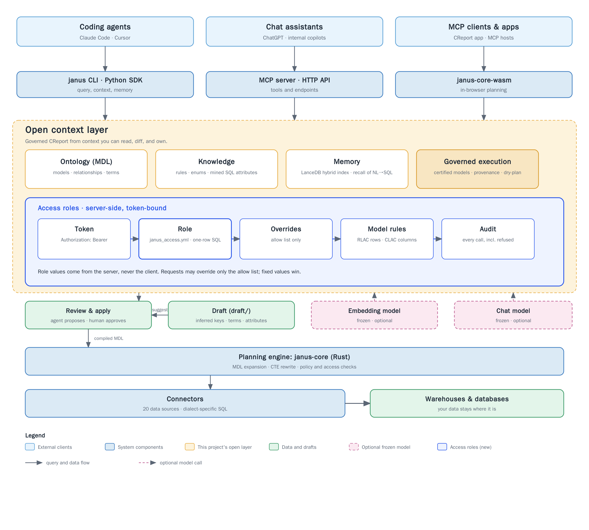

# Architecture, and what you can do with it

This page explains the architecture in the figure above, what it lets you do,
and how to use it well. The figure shows the whole path: who sends a request,
how the open context layer decides what the request may see, how the engine
plans the SQL, and where it runs.

## 1. The architecture, layer by layer

| Layer | What it is | Where it lives |
|---|---|---|
| **Callers** | Coding agents, chat assistants, MCP clients and apps. They send natural language, SQL, or MCP tool calls. | Your agents and apps |
| **Entry points** | `janus` CLI and Python SDK; the MCP server and HTTP API; `janus-core-wasm` for planning in the browser. | `janus` package, `janus-core-py`, `janus-core-wasm` |
| **Open context layer** | The governed knowledge the engine reasons with: ontology (MDL), knowledge, memory, governed execution, and access roles. | YAML and Markdown in your git repo, plus `janus_access.yml` on the server |
| **Review and drafts** | Generated drafts (inferred keys, terms, attributes) that a person reviews before they reach the models. | `draft/` in the project |
| **Planning engine** | `janus-core` (Rust, on DataFusion). Expands the models into SQL, rewrites CTEs, and applies policy and access checks. | Inside the engine |
| **Connectors** | Dialect-specific SQL for 20 data sources. | `janus` connector modules |
| **Warehouses and databases** | Your data, where it already lives. Nothing is copied or migrated. | Your infrastructure |

Two things make this different from a query tool that talks straight to the database:

- **The agent queries models, not tables.** The ontology says what each table
  means and how tables relate, so an agent does not guess joins.
- **The rules are part of the context, not part of the prompt.** Access rules
  and certification are enforced when the SQL is planned, so an agent cannot
  talk its way past them.

## 2. Access roles, step by step

The figure's band "Access roles" is the part most people ask about. A request
goes through five steps:

1. **Token.** The caller sends `Authorization: Bearer <token>`. The token is
   bound on the server to a default role. Tokens live in environment variables;
   the config file names them and holds no secrets.
2. **Role.** The role's values come from a one-row SQL on the server, run once
   at startup. A request cannot choose a role unless its token allows it.
3. **Overrides.** A request may change a property only if the property is on the
   role's allow list and the token may override. Fixed values set with
   `--property` cannot be changed by a request.
4. **Model rules.** The model's rules read those property values. A row rule
   filters rows; a column rule refuses a column the caller may not read.
5. **Audit.** Every call is written to the audit file, including the refused
   ones, with the token, the role, where each property value came from, and
   (if enabled) the SQL.

The rules a model can use are checked at startup against the roles. A rule that
depends on an optional property is refused, because an absent property would
silently drop the rule.

## 3. What you can do

**Answer business questions from governed models.** Agents query the models
(`orders`, `customers`), not the raw tables. Terms, relationships, and
certification tell the agent which definitions to trust.

**Give each person the rows and columns they should see.** One table can serve
an analyst (own orders, no margin column) and a manager (all orders, all
columns). Set it up once in the model rules and the role config; every surface
(CLI, API, MCP, SDK) applies it.

**Serve many agents from one place.** Coding agents, chat assistants, and apps
all use the same engine and the same rules. You do not write a separate access
layer for each.

**Let agents learn from confirmed questions.** Memory recalls queries that were
confirmed before, so a repeated question gets the proven SQL, not a new guess.

**Build and maintain the context from your database.** `janus context draft
--from-db` generates models and proposes relationships, terms, and attributes.
A person reviews them (`janus context draft apply`) before they reach the models.

**Catch drift.** `janus context diff` compares the YAML with the live database
and exits non-zero when they disagree.

**Audit and explain.** `janus access report` shows, for each role, which rows
and columns it can see. The audit file shows who asked what, and when a request
was refused.

**Run it where you want.** Locally with the CLI, as an HTTP service, as an MCP
server for coding agents, or in the browser with `janus-core-wasm`.

## 4. How to do it well

### Model

- **Certify what agents may use.** Mark reviewed models with
  `properties.certified: "true"`. A query that touches an uncertified model
  returns a warning. Turn on `require_certified` in `~/.janus/config.json` to
  refuse such queries outright.
- **Write the term and the aliases.** `properties.term` and
  `properties.aliases` are how an agent maps "customers" or "clients" to the
  right model.
- **Keep relationships explicit.** Declare them in `relationships.yml`. Inferred
  keys are suggestions until a person approves them.
- **Make every rule property required.** `required: true` on each property a row
  or column rule uses. The config check enforces this.

### Access

- **Keep role SQL constant or read-only.** A role's SQL should return one row of
  literals, or read a role table that only the security team can change.
- **Give each service its own token.** One token per backend service, bound to
  the least-privileged role that works. Use `may_override` only where the service
  needs it, and keep the allow list short.
- **Rotate tokens.** Store them in your secret manager and inject them as
  environment variables. Rotating a token means changing the variable and
  restarting the service; the config file does not change.
- **Check the config in CI.** Run `janus access report --access-config ...`
  on every change to the rules or the roles. It exits 1 on an error, which stops
  a bad config before it reaches the server.
- **Keep `--trust-client-properties` off** unless the server is local and only
  one person uses it. With an access config, you do not need it.
- **Read the audit file.** Refusals are the early warning: a spike in
  `role_not_allowed` or `override_not_allowed` means a caller is trying
  something it should not.

### Agents and queries

- **Dry-plan first** when you are unsure. `dry_plan` (or `/dry-plan`) shows the
  SQL with the filters applied, without reading any data.
- **Keep row limits.** The default cap is 1,000 rows and the maximum is 10,000.
  Do not raise them for agent traffic.
- **Ask for the columns you need.** `SELECT *` on a table with restricted
  columns fails for a caller who cannot read one of them. Name the columns.

## 5. Limits

- **A restricted column fails the whole query.** There is no "hide this column
  and return the rest" yet. A caller who asks for a column it cannot read gets
  `Permission Denied`. Design the queries you hand to agents with this in mind.
- **Role values are read at startup.** Change a role's SQL and restart the
  server. There is no reload.
- **Overrides are limited to the allow list.** Anything else needs a new role or
  a server-fixed value.
- **Execution against a real database is the last check.** The planning checks
  and the DuckDB demo pass. Run the same checks against your own warehouse before
  you rely on them.

## 6. Where to go next

- `core/janus/examples/access-roles/`: a runnable demo of the two roles over the
  HTTP API, with its configuration and expected output.
- `core/janus/examples/mcp-query/`: a runnable MCP query demo with no rules.
- `docs/core/reference/cli.md`: every command and flag, including `janus access
  report` and the `serve` options for access configs.
