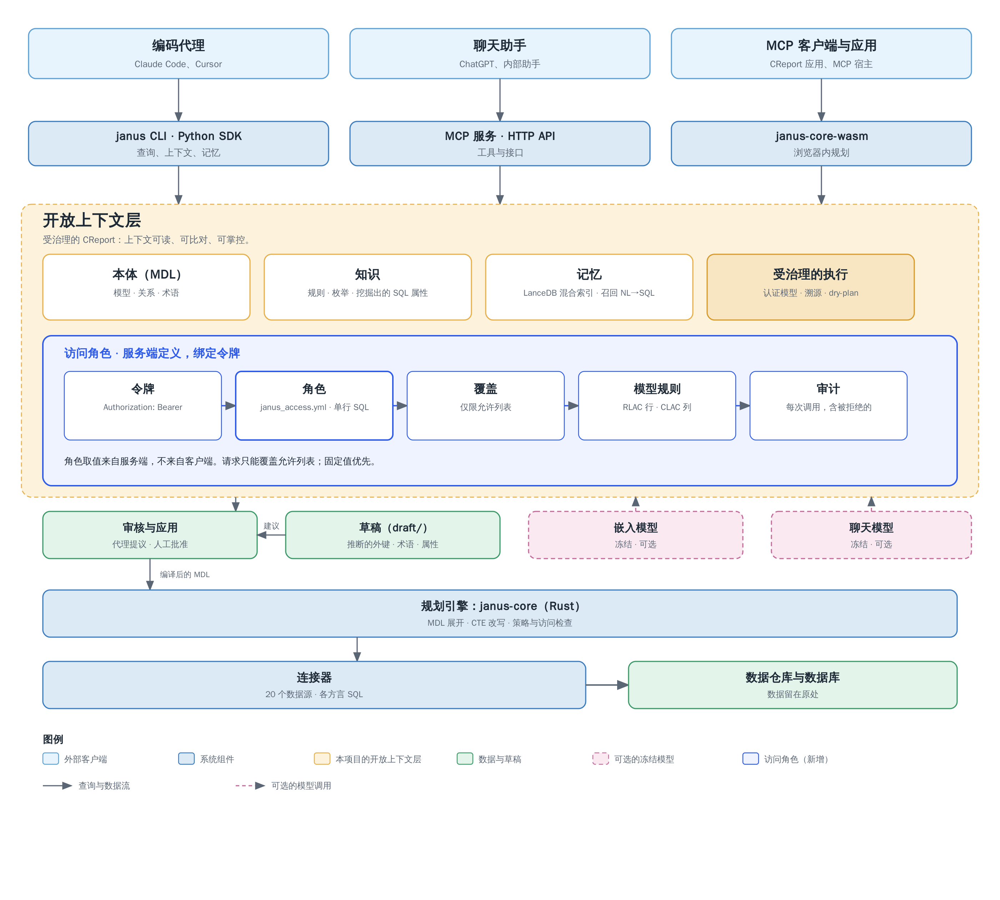

# 架构，以及你能用它做什么

本页解释上图的架构、它能做什么，以及怎样用得更好。图中展示了完整的路径：谁发起请求、开放上下文层如何决定请求能看到什么、规划引擎如何生成 SQL，以及 SQL 在哪里执行。

## 1. 架构：逐层说明

| 层 | 是什么 | 位置 |
|---|---|---|
| **调用方** | 编码代理、聊天助手、MCP 客户端与应用。它们发送自然语言、SQL 或 MCP 工具调用。 | 你自己的智能体和应用 |
| **入口** | `janus` CLI 与 Python SDK；MCP 服务与 HTTP API；用于浏览器内规划的 `janus-core-wasm`。 | `janus` 包、`janus-core-py`、`janus-core-wasm` |
| **开放上下文层** | 引擎推理时使用的受治理知识：本体（MDL）、知识、记忆、受治理的执行，以及访问角色。 | 你 git 仓库里的 YAML 和 Markdown，加上服务端的 `janus_access.yml` |
| **审核与草稿** | 生成的草稿（推断的外键、术语、属性），需要人工审核后才进入模型。 | 项目的 `draft/` 目录 |
| **规划引擎** | `janus-core`（Rust，基于 DataFusion）。把模型展开为 SQL，改写 CTE，并执行策略与访问检查。 | 引擎内部 |
| **连接器** | 面向 20 个数据源的各方言 SQL。 | `janus` 的连接器模块 |
| **数据仓库与数据库** | 你的数据，留在原处。不复制，也不迁移。 | 你自己的基础设施 |

这和直接连数据库的查询工具有两点不同：

- **智能体查询的是模型，而不是表。** 本体说明每张表代表什么、表与表如何关联，所以智能体不需要猜 join。
- **规则是上下文的一部分，而不是提示词的一部分。** 访问规则和认证状态在规划 SQL 时强制执行，智能体无法靠措辞绕过它们。

## 2. 访问角色：分五步

图中"访问角色"那一带是大家问得最多的部分。一次请求要经过五步：

1. **令牌。** 调用方发送 `Authorization: Bearer <令牌>`。服务端把令牌绑定到一个默认角色。令牌放在环境变量里；配置文件只写变量名，不存机密。
2. **角色。** 角色的取值来自服务端一条只返回一行的 SQL，启动时执行一次。除非令牌被允许，请求不能选择角色。
3. **覆盖。** 只有属性在角色的允许列表中，且令牌允许覆盖时，请求才能修改该属性。用 `--property` 设定的固定值，请求无法修改。
4. **模型规则。** 模型的规则读取这些属性值。行级规则过滤行；列级规则拒绝调用方无权读取的列。
5. **审计。** 每次调用都写入审计文件，包括被拒绝的调用。记录内容包括令牌、角色、每个属性值的来源，以及（如果开启）SQL。

启动时，系统会把模型规则和角色逐一对照检查。依赖可选属性的规则会被拒绝，因为属性缺失时规则会悄悄失效。

## 3. 你能用它做什么

**基于受治理的模型回答业务问题。** 智能体查询的是模型（如 `orders`、`customers`），而不是原始表。术语、关系和认证状态告诉智能体该信任哪些定义。

**让每个人只看到该看到的行和列。** 同一张表可以同时服务分析师（只看自己的订单，看不到利润列）和经理（看全部订单和全部列）。在模型规则和角色配置里设置一次，每个入口（CLI、API、MCP、SDK）都会执行同样的规则。

**一个地方服务多个智能体。** 编码代理、聊天助手和应用共用同一个引擎和同一套规则，不需要为每个智能体单独写一层访问控制。

**让智能体从已确认的问题中学习。** 记忆会召回之前确认过的查询，所以重复的问题拿到的是已验证的 SQL，而不是新的猜测。

**从数据库构建并维护上下文。** `janus context draft --from-db` 生成模型，并提议关系、术语和属性。人工审核（`janus context draft apply`）后才进入模型。

**发现漂移。** `janus context diff` 比较 YAML 与线上数据库，两者不一致时以非零退出码结束。

**审计与解释。** `janus access report` 按角色列出能看到的行和列。审计文件记录谁问了什么、何时被拒绝。

**按需部署。** 可以在本地用 CLI，作为 HTTP 服务，作为编码代理的 MCP 服务，或用 `janus-core-wasm` 在浏览器里运行。

## 4. 怎样用得更好

### 模型

- **只给智能体用认证过的模型。** 对审核过的模型设置 `properties.certified: "true"`。查询涉及未认证模型时会返回警告。如果要直接拒绝这类查询，在 `~/.janus/config.json` 中开启 `require_certified`。
- **写好术语和别名。** `properties.term` 和 `properties.aliases` 决定智能体把"客户"或"clients"映射到哪个模型。
- **关系写明确。** 在 `relationships.yml` 中声明关系。推断出的外键在人工批准前只是建议。
- **规则用到的属性都设为必需。** 行级或列级规则用到的每个属性都写 `required: true`。配置检查会强制这一点。

### 访问

- **角色 SQL 保持常量或只读。** 角色的 SQL 应该只返回一行字面量，或者读取一张只有安全团队能修改的角色表。
- **每个服务使用独立的令牌。** 每个后端服务一个令牌，绑定到能满足需求的最小权限角色。只在服务确实需要时才开启 `may_override`，并保持允许列表尽量短。
- **轮换令牌。** 令牌存放在密钥管理系统中，以环境变量注入。轮换令牌只需修改变量并重启服务，配置文件不需要改动。
- **在 CI 中检查配置。** 每次修改规则或角色时运行 `janus access report --access-config ...`。出现错误时退出码为 1，可以在配置上线前拦住问题。
- **除非服务只在本机、且只有一个人使用，否则保持 `--trust-client-properties` 关闭。** 有访问配置时不需要它。
- **定期查看审计文件。** 被拒绝的调用是早期预警：`role_not_allowed` 或 `override_not_allowed` 突然增多，说明有调用方在尝试它不该做的事。

### 智能体与查询

- **不确定时先 dry-plan。** `dry_plan`（或 `/dry-plan`）会显示套用过滤条件后的 SQL，而不读取任何数据。
- **保留行数上限。** 默认上限为 1,000 行，最大为 10,000 行。不要为智能体流量放宽这个限制。
- **只请求需要的列。** 对有受限列的表使用 `SELECT *`，对无权读取其中一列的调用方会失败。请明确列出列名。

## 5. 限制

- **受限的列会让整条查询失败。** 目前还没有"隐藏这一列、其余照常返回"的功能。调用方请求了无权读取的列，就会收到 `Permission Denied`。交给智能体的查询要考虑这一点。
- **角色取值在启动时读取。** 修改角色的 SQL 后需要重启服务，没有热加载。
- **覆盖只限于允许列表。** 其他属性需要新的角色，或由服务端固定。
- **真实数据库上的执行仍是最后一道检查。** 规划检查和 DuckDB 演示都已通过。依赖之前，请在你自己的数据仓库上运行同样的检查。

## 6. 接下来看什么

- `core/janus/examples/access-roles/`：通过 HTTP API 运行两种角色的可执行演示，附配置和预期输出。
- `core/janus/examples/mcp-query/`：没有任何规则的 MCP 查询演示。
- `docs/core/reference/cli.md`：所有命令和参数，包括 `janus access report` 以及访问配置相关的 `serve` 选项。
