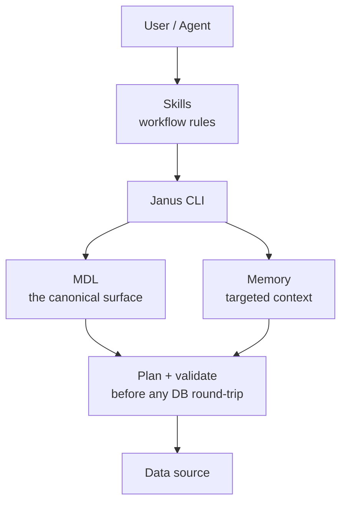

# Janus AI 如何防止智能体产生幻觉？

业务数据上的幻觉很少是"模型不擅长 SQL"的问题，而大多是上下文缺失的问题。智能体在它并不真正理解的数据上，写出一条看起来自信的查询。在 CReport 中，这种风险会不断累积：基于错误查询构建的仪表盘看起来很权威，因此正确性是一切的核心。

Janus AI 的架构旨在**在每一步都为智能体提供所需的上下文**，并且**当智能体开始猜测时明确失败**。以下是各个部分如何协同工作。

## 系统的结构



在智能体的问题与数据库之间有五层：

| 层 | 作用 | 如何防止幻觉 |
|---|---|---|
| **技能** | 编码智能体必须遵循的工作流 | 智能体无法跳过"检查记忆"或"执行前校验"等步骤 |
| **MDL** | 声明智能体被允许使用的每一张表、每一列和每一种关系 | 智能体只能引用已建模的对象，因此未声明的列和遗留表对它不可见 |
| **记忆** | 为 MDL + `knowledge/rules/` + `knowledge/sql/` 建立索引；按问题只检索相关部分 | 智能体读取的是相关切片，而不是通用的 Schema 转储 |
| **规划与校验** | 在任何数据库往返之前，把建模 SQL 展开为将要实际运行的 SQL | 错误的引用会在规划阶段以清晰的错误失败，而不是在生产环境中悄无声息地出错 |
| **连接器** | 将规划好的 SQL 在数据源上执行 | 类型、方言和权限检查在此进行 |

## 每一层阻止什么

### MDL：智能体无法引用未建模的内容

原始数据仓库会给智能体带来模糊的关联、近似重复的表（`customers` 与 `customers_v3` 与 `loyalty_v3`），以及在多个 Schema 中重叠的列。MDL 把这些问题收敛为一个权威的接口。

如果 `customers` 模型中没有 `email`，智能体就无法查询它。在 Janus AI 对你数据的视图中，它根本不存在。如果 `orders` 与 `customers` 之间的标准关联在 MDL 中只声明一次，智能体就无需自己发明它。

### 记忆：有针对性的检索胜过转储 Schema

两种常见的失败模式：

- **把整个 Schema 转储进提示词** → 模型被无关的表搞糊涂。
- **让模型自行猜测**哪些表相关 → 它挑中了错误的表。

记忆两者都不做。它为 MDL + `knowledge/rules/` + 经过确认的自然语言到 SQL 配对（`knowledge/sql/`）建立索引，只检索与问题匹配的部分。智能体读取的是 `customers`、`orders` 以及经过批准的收入计算，而不是 500 张表。

### 规划与校验：错误可见地失败

`janus dry-plan` 接收智能体的建模 SQL，并将其展开为将要在数据库上运行的确切 SQL。智能体和你都可以看到：

- Catalog 和 schema 的解析结果
- 以 CTE 形式内联的关系连接
- 从业务规则（`knowledge/rules/`）注入的策略过滤条件
- 强制执行的列级访问控制

如果列名写错了，dry-plan 会返回可用的列；如果缺少某个关系，它会明确指出。智能体会根据这些信息重试，而不是运行错误的 SQL 并报告一个错误的数字。

### 技能：工作流不由智能体自行发明

技能是 Markdown 格式的工作流指南。它们告诉智能体操作的先后顺序：先检查记忆，然后基于 MDL 编写 SQL，接着 dry-plan，再执行，最后保存经过确认的配对。智能体无法跳过任何步骤。

这一点很重要，因为最常见的失败模式是"模型没问题，但围绕它的工作流缺失"。技能正是为了提供这套工作流。

## 智能体看到什么

对于"本季度终身价值最高的 5 位客户"这样的问题，流程如下：

```text
1. janus memory recall  -q "top customers by revenue"
   → returns 2 similar past NL-SQL pairs

2. janus memory fetch    -q "customer lifetime value"
   → returns customers model + customer_lifetime_value column + active-customer instruction

3. agent writes SQL against MDL:
   SELECT first_name, customer_lifetime_value
   FROM customers
   ORDER BY 2 DESC LIMIT 5;

4. janus dry-plan
   → expands to planned SQL with the active-customer filter injected

5. janus --sql ...
   → executes against the database

6. janus memory store --nl "..." --sql "..."
   → next similar question gets this as a recall
```

每一步都是智能体调用的一个基本原语。推理过程保留在智能体的推理之中，供你审阅其工作。这里没有需要你额外信任的独立"正确性仪表盘"。

## 另请参阅

- [架构](/oss/reference/architecture)：完整的技术细节
- [智能体如何从你的上下文中学习？](/oss/concepts/agent_learning)：记忆与技能的闭环
- [MDL 对智能体有什么作用？](/oss/concepts/what_is_mdl)：为什么 MDL 是权威接口
