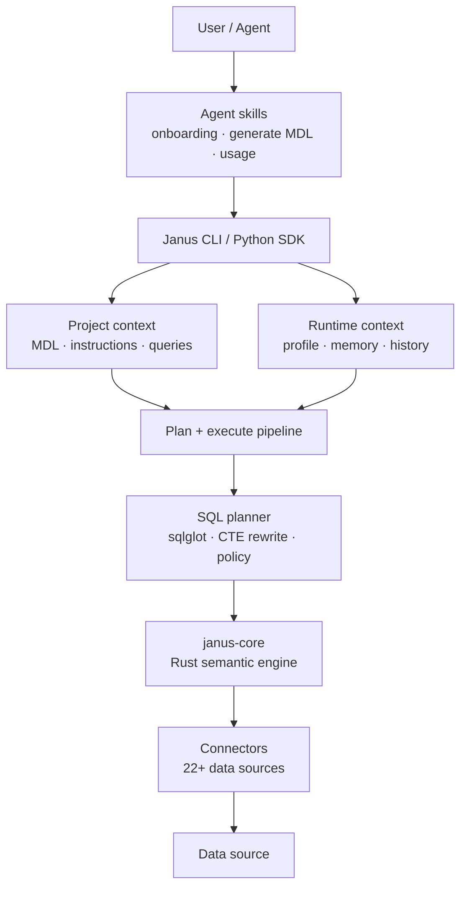
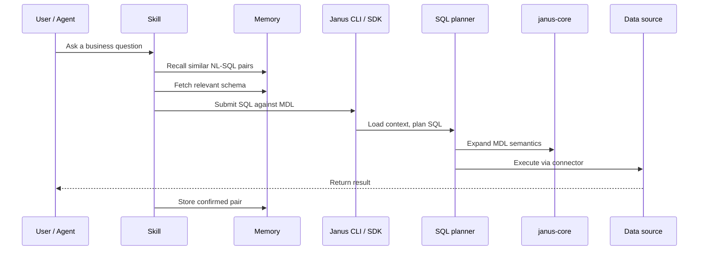

# 架构

Janus AI 的构建目标是一个面向智能体的开放上下文层。从架构上看，这意味着两件事：

1. 业务含义存放在明确的项目产物中：MDL、指令、配置文件和记忆。
2. 正确性被视为一组智能体可以编排的原语组成的系统，而不是某个隐藏的功能。

最终的结果是一个分层的技术栈：智能体可以借助受治理的业务上下文，生成受治理的 BI，从一条 SQL 答案到已部署的 CReport 仪表盘。建模、规划、校验、执行和召回都由 Janus AI 处理。

## 正确性是一个系统

Text-to-SQL 不会因为存在某个元数据字段或某条巧妙的提示词而变得可靠。只有当多个环节协同工作时，它才会可靠。

| 支柱 | 含义 | 在 Janus AI 中的位置 |
| --- | --- | --- |
| **Schema 链接** | 知道哪些模型、列和关联关系与某个问题相关。 | MDL + 记忆检索（`janus memory fetch`） |
| **取值画像** | 知道数据中实际出现了哪些值，例如 `status = 4` 代表什么。 | 连接器行为、画像工作流、索引到记忆中的指令 |
| **歧义检测** | 知道什么时候问题描述不完整，需要进一步澄清。 | 由智能体编排的 Skill |
| **生成追踪** | 展示答案是如何构建的：模型、join、CTE 以及展开后的 SQL。 | `janus dry-plan` |
| **重试与修复** | 在生成的 SQL 执行失败或指向错误的建模对象时进行恢复。 | 结构化错误、`janus dry-run`、智能体重试工作流 |
| **评测** | 当 Schema、定义或提示词变化时，检测回归。 | 开发中的黄金 NL-SQL 评测工作流 |

Janus AI 将这些能力作为原语提供。智能体自行决定何时检索、召回、dry-plan、执行、修复或请求澄清。追踪信息始终可见，位于智能体推理发生的地方。

## 系统概览

从高层看，Janus AI 有四个层次：

| 层 | 职责 |
| --- | --- |
| **智能体工作流** | Skill 引导智能体完成初始化、MDL 生成、查询、校验和记忆更新。 |
| **项目上下文** | MDL、指令、配置文件和记忆描述数据的含义以及应当如何使用。 |
| **规划引擎** | Janus AI 借助语义引擎和 SQL 规划器，把建模 SQL 展开为可执行的 SQL。 |
| **执行层** | 连接器在目标数据源上运行规划好的 SQL，并返回结果。 |



同一套架构也可以从查询路径的角度来理解：



## 核心组件

### 智能体 Skill

[Skill](/oss/reference/skills) 是 Markdown 形式的工作流，告诉 AI 编码智能体如何安全地操作 Janus AI。它们编码了诸如"在查询之前先构建 MDL"、"在编写 SQL 之前先获取上下文"以及"成功之后保存经过确认的示例"等流程。

Skill 位于 CLI 之上。它们不会隐藏底层原语，而是帮助智能体按正确的顺序使用这些原语。

### Janus CLI

CLI 是智能体和开发者的主要交互界面。它负责发现项目、解析激活的配置文件，并把命令路由到正确的子系统。

| 命令 | 功能 |
| --- | --- |
| `janus query` / `janus --sql` | 规划并执行 SQL，然后返回结果。 |
| `janus dry-plan` | 规划 SQL 并展示展开后的 SQL，但不执行。 |
| `janus dry-run` | 在真实数据库上校验 SQL，但不返回任何行。 |
| `janus context` | 初始化、校验、构建和检查 Janus 项目。 |
| `janus profile` | 管理数据库连接配置文件。 |
| `janus memory` | 为上下文建立索引、检索 Schema 条目、召回示例，并保存经过确认的查询。 |
| `janus utils` | 运行类型规范化等辅助操作。 |

### 项目上下文

Janus 项目是一个可移植的上下文包，对应一个业务数据层。

它包括：

- **MDL 源文件**：模型、关联关系、视图、Cube 和项目元数据。
- **`knowledge/`**：业务规则（`rules/`）和经过确认的 NL→SQL 问答对（`sql/`），是记忆的事实来源。
- **`target/mdl.json`**：引擎使用的编译后 MDL manifest。
- **`.janus/memory/`**：由 `knowledge/` 重建的派生 LanceDB 索引（可选），用于语义检索。

连接配置文件单独存放在 `~/.janus/profiles.yml` 中，使凭据与具体环境保持分离。

完整的项目结构参见 [MDL Schema 参考](/oss/reference/mdl)。

### Janus Python SDK

`janusai` Python 包暴露了 CLI 所驱动的同一套规划-执行流水线。CLI 是对 SDK 的一层薄薄的 Typer 封装。两者共享编排代码，并且都可以嵌入到智能体框架、Notebook 和应用中。

无论通过 CLI 还是 SDK 调用，编排器都会：

1. 接收建模 SQL。
2. 加载编译后的 MDL manifest 和激活的连接配置文件。
3. 调用 SQL 规划子系统（sqlglot + CTE 重写 + janus-core）。
4. 把规划好的 SQL 发送到正确的连接器。
5. 以 PyArrow 表的形式返回结果。

更高层的集成参见 [LangChain SDK](/oss/sdk/langchain) 和 [Pydantic AI SDK](/oss/sdk/pydantic)。两者都把这套流水线封装为智能体工具。

### SQL 规划

SQL 规划器会把针对建模对象编写的 SQL 转换为目标数据库可以执行的 SQL。

三个部分协同工作：

- **sqlglot** 解析 SQL、限定表和列引用，并在 SQL 方言之间进行转译。
- **CTE 重写器** 识别被引用的 MDL 对象，并把展开后的模型 SQL 注入为 CTE。
- **janus-core** 展开 MDL 语义：模型、关联关系、计算字段和视图。

```text
针对 MDL 的用户 SQL
  |
  |-- 解析并限定 SQL
  |-- 识别被引用的模型/视图
  |-- 提取相关的 MDL manifest 片段
  |-- 通过 janus-core 展开模型和计算字段
  |-- 注入展开后的 CTE
  |-- 运行策略检查
  |-- 转译为目标方言
  |
  v
可在已连接数据源上执行的 SQL
```

### janus-core

`janus-core` 是 Rust 语义引擎。它通过 PyO3 绑定暴露给 Python，并作为 MDL 语义的事实来源。

它负责：

- 在会话上下文中维护 MDL 状态
- 仅提取查询所需的 manifest 对象
- 展开 `table_reference` 和 `ref_sql` 模型
- 解析计算字段
- 展开感知关联关系的表达式
- 规定建模对象如何映射为 SQL

### 连接器

连接器在目标数据库上执行规划好的 SQL。每个连接器都实现统一的接口，用于查询执行、dry-run 校验、类型处理和连接生命周期管理。

支持的数据源包括 PostgreSQL、MySQL、BigQuery、Snowflake、DuckDB、ClickHouse、Trino、SQL Server、Databricks、Redshift、Oracle、Athena、Apache Spark 等。

### 记忆层

[记忆系统](/oss/concepts/memory_system)是基于 LanceDB 的检索层，包含两个主要集合：

| 集合 | 内容 | 用途 |
| --- | --- | --- |
| `schema_items` | 模型、列、关联关系、视图、Cube 和指令 | 为每个问题检索正确的上下文。 |
| `query_history` | 经过确认的自然语言到 SQL 的问答对 | 召回以前有效的示例。 |

记忆会把使用过程转化为行为上下文。每一条经过确认的查询都可以成为未来的示例。

## 数据流

### 查询执行

```text
janus --sql "SELECT customer_id, SUM(total) FROM orders GROUP BY 1"
  |
  |-- 1. 发现项目：janus_project.yml -> target/mdl.json
  |-- 2. 解析配置文件：~/.janus/profiles.yml
  |-- 3. 规划：解析 -> 提取 MDL -> 展开 CTE -> 转译
  |-- 4. 执行：连接器 -> 数据库 -> PyArrow 表
  |-- 5. 输出：表格、CSV、JSON 或 SDK 返回值
```

### 智能体辅助查询

```text
用户提出业务问题
  |
  |-- Skill 选择查询工作流
  |-- 记忆召回相似的、已接受的 NL-SQL 问答对
  |-- 记忆获取相关的 Schema 和指令
  |-- 智能体针对 MDL 对象编写 SQL
  |-- Janus AI 进行 dry-plan、校验或执行
  |-- 如有需要，智能体修复或请求澄清
  |-- 经过确认的答案被写回记忆
```

### 项目构建

```text
janus context build
  |
  |-- 读取 janus_project.yml
  |-- 读取模型、视图、Cube 和关联关系
  |-- 校验结构和引用
  |-- 把源 YAML 编译为 target/mdl.json
```

### 记忆生命周期

```text
janus memory index           -> 解析 MDL 和指令，构建 schema_items
janus memory fetch -q "..."  -> 检索相关的 Schema 上下文
janus memory recall -q "..." -> 检索相似的、已确认的示例
janus memory store           -> 把新的 NL-SQL 问答对追加到 query_history
```

## 关键依赖

| 依赖 | 作用 |
| --- | --- |
| `janus-core-py` | Rust 语义引擎的 Python 绑定。 |
| `sqlglot` | SQL 解析、限定和方言转译。 |
| 数据库连接器 | 受支持数据源的执行层。 |
| `pyarrow` | 查询结果的表示形式。 |
| `lancedb` | 记忆的向量存储。 |
| `sentence-transformers` | 记忆搜索的本地嵌入。 |
| `typer` | CLI 框架。 |
| `pydantic` | 配置和连接校验。 |

## 总结

Janus AI 的架构把上下文与执行分离：

- 项目文件定义数据的含义
- 记忆检索相关的上下文和示例
- Skill 告诉智能体如何安全地操作
- 规划器和 Rust 引擎把建模 SQL 转换为可执行的 SQL
- 连接器在数据库上运行这些 SQL

正是这种分离，使 Janus AI 具备可移植性、可检查性，并且以智能体为原生设计。
