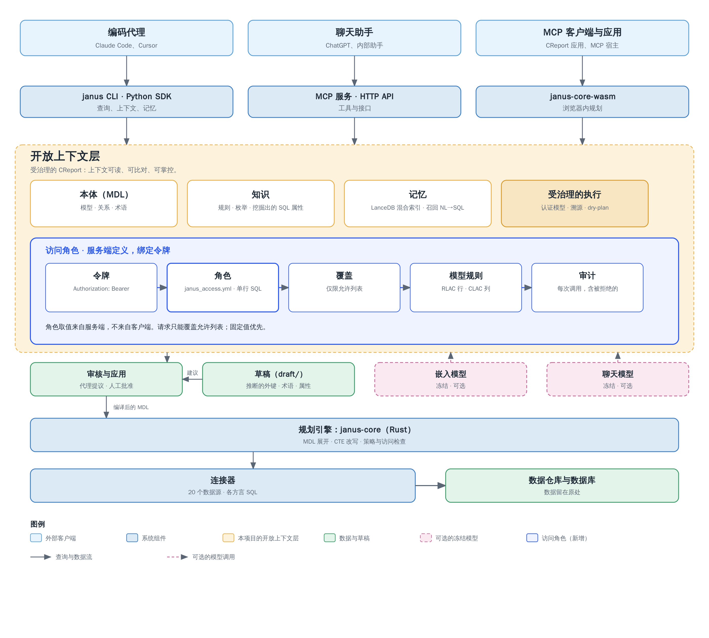

# 智能体会写 SQL，却不懂你的业务

**Janus 给 AI 智能体装上一张业务地图，让它们像懂行的同事一样取数。**

## 一、架构：一条从提问到数据的受控路径

智能体提出问题，Janus 在中间做三件事，然后才让数据库执行。

- **入口**：命令行、Python SDK、MCP 服务、HTTP API，以及浏览器内的规划器。Claude Code、Cursor、聊天助手、内部应用，都接入同一个入口。
- **开放上下文层**：这是 Janus 的核心，由五部分组成：
  - **本体**：每张表代表什么，表之间怎么关联，哪些定义已经认证；
  - **知识**：业务规则、枚举值，以及从历史查询中挖掘出的常用计算方式；
  - **记忆**：召回已经确认过的问题和 SQL；
  - **受治理的执行**：只允许执行认证过的模型，并给出溯源信息；
  - **访问角色**：令牌决定角色，角色决定能看哪些行和列，每次调用都有审计。
- **规划引擎**：把模型展开成正确的 SQL，再交给你的数据仓库执行。数据不搬家，20 个数据源各用各的方言。

## 二、它解决什么问题

**问题一：智能体猜表、猜 join，结果看似正确、其实错了。**
Janus 让智能体查的是模型，关系和术语都已经写清楚。它不需要猜，也就不容易悄悄出错。

**问题二：同一份数据，不同的人应该看到不同的内容。**
过去要么为每个角色复制一份视图，要么在提示词里叮嘱"别看利润"。现在，分析师只看到自己的订单，经理看到全部，规则写一次，对所有入口生效。

**问题三：智能体要接很多个，权限和口径各管各的。**
编码代理、聊天助手、内部应用，各自写一套取数逻辑，口径越来越乱。Janus 让它们共用同一套语义层和同一套规则。

**问题四：上下文散落在文档、聊天记录和某个人的脑子里。**
Janus 把它们收进你自己的 git 仓库，用 YAML 和 Markdown 保存，有变化可以审阅、比对、回滚，`janus context diff` 还能发现它和真实数据库的偏差。

**问题五：不知道智能体到底做了什么。**
每次调用都有审计记录：谁的令牌、用了哪个角色、哪些属性来自请求、执行的 SQL 是什么，被拒绝的调用也记下来。

## 三、它能带来什么

- **数据更可信。** 认证过的模型优先，未认证的模型会给出警告，也可以直接拒绝。
- **权限说了算。** 行级和列级规则在规划时强制执行，不依赖智能体的自觉。
- **上线更快。** 从数据库生成模型和草稿，人工审核后即可使用，不必从零搭建语义层。
- **维护更省心。** 上下文是普通文件，改动可审阅，偏差可检测。
- **越用越准。** 记忆召回已确认的查询，重复的问题拿到的是验证过的 SQL。
- **上线前有把关。** `janus access report` 检查角色与规则是否一致，配置有误，服务不会启动。

---

**Janus：让每个智能体都按同一套业务规则取数。**

运行 `core/janus/examples/access-roles/run_demo.sh`，五分钟看到两种角色在同一张表上的不同结果。
